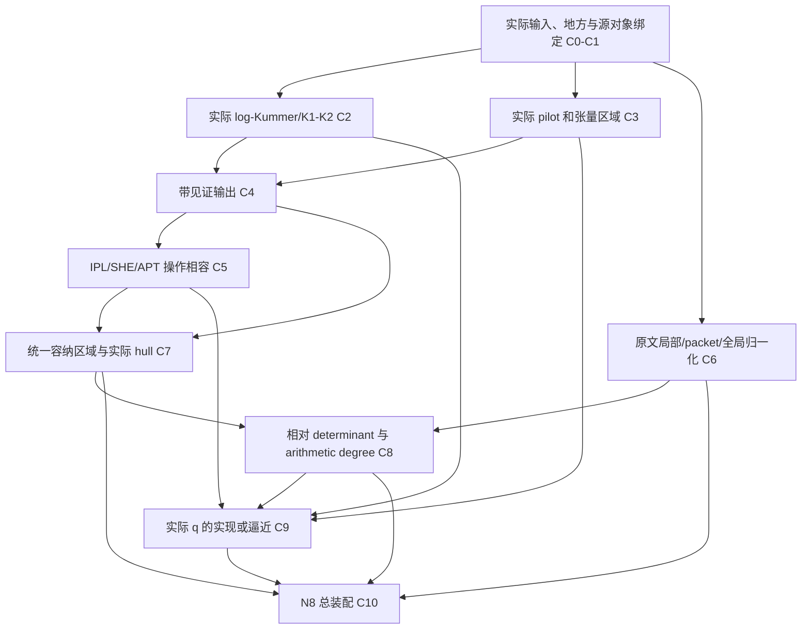

# N8 闭合路线：从一个实际源终点倒排整条证明

日期：2026-10-22。用户目标是闭合 N8；本文件据此替换“每组找一个最小引理，六组都交付就算闭环”的工作顺序。当前 chat 只编写路线，不派发 agent、不改 Lean 证明。后续项目执行按 SHEAF 分组并行。

**路线决定：以实际源输入 → 带见证的多径向算法 → 双侧算法相容 → 实际区域 hull → 统一归一化和算术次数 → 实际 q 的输出实现/逼近 → Corollary 3.12 为唯一主链。** 底层、陈述、上层证明可以交错推进；每包必须减少这条链上的一个明确缺口。

## 1. 什么才算本路线的闭合

### 最终数学终点

给定原文允许的 initial Θ-data 与 log-theta-lattice，保持原文对素数、地方、标签及 `n,m : ℤ` 的量词，交付：

1. Theorem 3.11 的实际数据 (a)(b)(c) 及其构造；Ind1/Ind2 按实际作用/许可关系处理，Ind3 保留原文包含/满射方向与独立的 log-volume 精确相容性。
2. 同一构造的 IPL/SHE/APT 性质，带实际源对象和共同选择/操作来源。
3. Corollary 3.12 所用实际可能像区域的 holomorphic hull、原文归一化 log-volume，以及需要的算术 degree 比较。
4. 实际 q-pilot 的值 `Q(I)`、实际 theta hull 的值 `Θ(I)`，并证明 `Θ(I)` 有限且 `Q(I) ≤ Θ(I)`。

`Q(I)` 和 `Θ(I)` 是原文 `−|log(q)|`、`−|log(Θ)|` 的有符号量；名称中的符号不能被实现为任意传入实数。完整 Theorem 3.11 属性和 Ob3-3 所需次数比较仍是交付，不能只证明最后一个弱不等式后删除前面的论文目标。

后续 ABC 接口是本路线的消费者。N8 先交上述源定理、次数/体积字典及准确调用接口；`Cor312EpsilonArithmeticComparison` 的两条 IUT IV §2 高度比较若尚未证明，另列下游任务，不把 N8 的名称无限扩大为整个 ABC 证明。

### 当前应首先达到的整链验收

用户允许按任意阶段推进，因此先完成 **N8 的整体陈述及依赖闭合**，随后持续消去证明义务：

- 一个总目标文件引用实际定义；允许符合 [SORRY-POLICY](SORRY-POLICY.md) 的具名定理缺口。
- 六组的实际结果在同一个源输入、索引、算法见证、区域及数值约定下组合；不存在未登记的类型转换。
- 总定理证明体实际调用这条链。缺失定理在下层具名登记，不能把总目标本身写成一个 `sorry` 就宣布整链接通。
- 总定理不额外接受待证的 `ipl`、`she`、`apt`、`q_le_hull`、`degree_preserved` 或任意 `possibleImage`。
- 每个新缺口对应完整命题、来源、消费者和证明路线/明确缺失构造；疑似错误命题先修正，不能准入。

这项验收完成时写“**N8 整链 statement/dependency closure**”；剩余 `sorry` 清零、传递公理审计和目标语义验收通过后才写“**N8 数学闭合**”。不再用“六份 stage1 记录”或“六个小引理通过”替代上述任何一项。

## 2. 现在必须做出的五个实现选择

### 选择一：统一实际输入，不把六组各自的对象拼成元组

以同一组原文合格输入 `I` 为索引，地方、完成域、prime-strip、log-shell、pilot、输出、区域都从它派生。现有 `OriginalInput` 是待审查/复用入口，不因名字就视为足够忠实：当前 `V` 与算术地方、prime-strip 与当地完成域等仍需实际比较。

原文已经给定的合格 theater/lattice 是合法输入；不把“从任意较弱算术数据制造全部 theater”强加为当前 N8 的前提。反过来，原文要由算法产生的对象和性质不能偷放进输入。第一包必须逐项列清两者。

### 选择二：group3 直接进入实际局部域/张量区域

选实际局部元素、Kummer 类、整数格及张量区域作为主载体。实际 q 先是对应完成域中的元素；实数 log-degree 是之后的数值读出，不把实数标量随意映射进积分值幺半群作为源构造。

现有 `SourceImageHull` 的 full-hull/degree-faithful 桥已有不可同时满足的边界记录；group3 A1 还报告了 `SourceImageRealization` 的额外不可实例化论证，但 A1 尚未 Lean 验证。无需以 A1 为已证定理：这条新路线直接按源对象构造，避免依赖有争议的逆向实数载体。

保留旧条件定理作为供体/历史，不再通过增加 `hdeg`、`hunit` 或存在字段强行实例化旧模型。

### 选择三：group4 保留构造见证，不把 possibleImage 留作自由字段

对实际输入 `x` 定义受源条件约束的选择类型 `C(I,n,x)`，实际求值 `eval`，随后定义：

```text
U(I,n,x) = { y | ∃ c : C(I,n,x), eval(I,n,x,c) = y }.
```

这里 `eval` 的目标是原文实际输出数据/区域所在的类型，不是任意 `Real`；数值量在后续读出。`C` 包括各地方来自同一整体选择所需的约束，不能用任意自由积或 `PUnit` 替代。

若旧 `Choice → Real` 接口忘掉内部见证，采用依赖对 `Σ c, inner c` 保留见证，或直接让区域/轨道成为输出。**不新增“所有内部见证数值相同”的假设来迁就旧接口。** 到旧 Profile 的适配只在实际需要且可证明时做；总链可直接消费新构造。

### 选择四：group5 做实际算法相容，不要求整个 Strip/Output 类型双射

选择 B 中可复用的族关系修正，但把 A 的实际源实现作为主链必须完成的节点，不永久挂起。目标是同一算法在两侧结构中的解释、实际许可族及操作对应。

原文 APT 明确不是任意集合函数的运输。故不默认要求 `FPrimeStrip ≃ Output ≃ Choice` 或一个全局 `Output₀ ≃ Output₁`。需要严格等式、许可同构下相容还是商上关系，由具体原文操作决定。

首先处理 Remark 3.10.2 的 Kummer 竖箭头与 evaluation 复合；其域、陪域、算法步骤、两侧解释必须具体落在源对象上。再由组合规律扩展至所需算法。

### 选择五：group6 使用实际 λO-hull 和原文归一化

局部 hull 复用 `LocalFieldProductHull` 的坐标格/区域路线，先证明实际可能像有统一容纳区域，再推有限体积。不能以“对所有缩放封闭的子幺半群”替代原文 λO 区域。

局部采用 IV Proposition 1.4(i) 的 degree-normalized log-volume；全局/packet 权重按 IV Remark 1.7.1 转换，最后按 III 的正确 procession 标签集归一化。不能只除一个 `finrank` 就视为全部完成。

## 3. 总链怎样拼起来

以下是证明依赖图；不是固定的阶段时间表，也不是已经完成的依赖提取。



`C6` 的通用权重运算、`C7` 的通用 λO-hull、`C8` 的一般局部行列式恒等式可独立证明；它们的源实例等待相应真实输入。`C10` 可以在子定理仍有具名缺口时编译和试证，不能等所有底层彻底证完才发现接口不通。

## 4. 十一个问题包及明确出口

下面是拟议文件名与接口职责，不是现有已证明声明。统一放在 `tmp/sheaf/n8/closure/`，由现有相关 owner 接手；先检查已有同义定义，能复用就只增加必要桥。生成最终生产命名时按仓库约定调整。

| 包 | 拟议文件 / 负责人职责 | 实际交付和直接消费者 |
|---|---|---|
| C0 | `TargetSignature.lean`；目标/集成负责人 | 冻结 N8 原文输入与输出命题；定义仅用真实数学对象。C1–C10 都使用同一签名 |
| C1 | `SourceInputBinding.lean`；group1 | 同一数域/地方及 strip/Frobenioid/theater 的实际对象比较；给 C2、C3、C6 的源索引 |
| C2 | `SourceLogKummerRealization.lean`；group2 | 实际 log、核/像、Kummer 箭头、作用下降及所需 K1/K2；供 C4、C5、C9 |
| C3 | `SourcePilotRegion.lean`；group3 | 实际 q/theta-pilot、Kummer 表示、张量/区域落点及改根相容；供 C4、C9 |
| C4 | `SourceWitnessedOutput.lean`；group4 | 定义实际受约束选择、求值与可能像，证明所需 Ind 律；供 C5、C7 |
| C5 | `SourceAlgorithmCompatibility.lean`；group5 | 从实际源操作证明 IPL/SHE/APT、相容选择及必要的单向/双向关系；供 C7、C9 |
| C6 | `PaperNormalizedVolume.lean`；group6 数值包 | 局部 log、地方/tuple 权重、procession 平均、数值重索引；供 C8–C10 |
| C7 | `SourceHolomorphicHull.lean`；group6 区域包 | 实际全族像的统一控制、λO-hull、正有限体积；供 C8–C10 |
| C8 | `SourceDegreeComparison.lean`；group6 与 group1 的明确接口 | 实际相对 determinant、tensor 幂与全局 arithmetic degree/log-volume 等式；供 C9、C10 |
| C9 | `SourcePilotApproximation.lean`；group5/6 共同问题，由一个 owner 集成 | 对实际 q 值构造允许输出值或逼近序列，消掉现有 `hq` 前提；供 C10 |
| C10 | `N8Assembly.lean`；集成负责人 | 从 C0 原输入调用 C1–C9，给出源 3.11、实际源 3.12 和次数接口；不再向调用者索要结论 |

### C0：先固定这个总目标，禁止以后换成小定理

总目标的数学规格如下；它是待展开的规格，不是已可编译的 Lean 名称：

```text
对原文允许的每份源输入 I：
  构造源 3.11 数据 (a)(b)(c)，满足其 Ind/函子性/跨列结论；
  该构造满足原文 IPL/SHE/APT；
  其实际区域的 hull 和 q-pilot 使用同一原文数值读出；
  arithmetic degree 与该 log-volume 按原文 determinant/权重对应；
  theta hull 的该 log-volume 有限；
  实际 q-pilot 的值 ≤ 实际 theta hull 的值。
```

把现有 `SourceP1P2Bundle`、`K2FrobenioidBoundary` 等字段逐个归类为原文输入或待构造结果；待构造结果在链内由具名定理产出。不能把它们原封不动全放在总目标参数中。

### C1–C3：输出必须带实际来源

- C1 的 Frobenioid 不能只是投影 `I` 中另一个已有字段；应补地方集、局部值、有限支撑、全局比较与源 strip 的对应。已有局部理想/degree 供体直接复用。
- C2 的 `log` 是实际局部 log，不能用 `ind3` 重命名。已有 `descends_iff` 负责通用下降；真实作用保持核、实际 Kummer 对应和 K1/K2 的比较是本包要填的内容。
- C3 的 q 是实际完成域中的 q；其范数/valuation/实数 log 的关系是定理。theta 输出与 q-side 来自同一源数据及许可根选择，不能只凭“都有叫 q 的参数”对接。
- 几何基本群、source theta section、Tate 参数化等底层内容，只有在这些精确源命题实际需要时才展开为子节点；已属于原文合格输入的结构不重复从零构造。

### C4–C5：将模型自由度替换成算法来源

选择类型 `C(I,n,x)` 和每一步 `eval` 一旦固定，`possibleImage` 由像集定义。其非空性来自实际许可选择，不能由任意 `Nonempty Output` 顶替。

Ind1/Ind2 使用原文实际作用及必要商关系；不要为沿用旧 `Core` 强求代表上的交换等式。Ind3 的包含/满射与 Kummer/log-volume 的精确相容分成不同定理。

许可族 `P` 必须从源算法得到。`familyRel` 是辅助表示；已有逐成员交换假设下的定理可复用。若源只给许可族在共轭下稳定，则改用集合级稳定证明换向，不额外假设每个成员都交换。`polyIsoRel ⊆ familyRel` 不算原文复合族覆盖 `QP ⊆ R` 的实现。

跨列过程使用同一源算法选择的运输。先证对一个实际操作的相容，再证复合/许可选择覆盖。原文只需要包含时不额外强求双射；确需反向包含时必须给出许可选择的覆盖证明。

### C6：按原文把数值约定锁死

令局部块维数为 `D`、参考格子为 `O`：

```text
Lμ(S) = log ((μ S).toReal)
Vμ(S) = (Lμ(S) - Lμ(O)) / D
Lμ(S) = D * Vμ(S) + Lμ(O),  D ≠ 0.
```

已有 `Group6Normalization.lean` 已按此修正，当前队列记录其局部编译通过；不重新另写同义引理。已有 `arithmeticTupleNormalizedLogVolume_primeScalar_zpow` 提供 `Vμ(p^k O) = -k log p` 的校准。

按 IV Remark 1.7.1，对地方 `v | v̲ | p`，从旧权重改为：

```text
[K_v : (F_mod)_v̲]⁻¹
    → [K_v : Q_p] / [K_v : (F_mod)_v̲]
    = [(F_mod)_v̲ : Q_p] = λ_v̲.
```

tuple 权重用 `∏ λ` 后除以全部许可 tuple 的乘积权重之和；tuple 允许重复地方。证明当前 Lean 索引与这些 tuple 对应，并核对分母非零。再处理原文的 procession 平均，不把 ZMod 标签、SignedLabel 或旧模型基数当成同一个索引。

要交付源实例下的数值识别；仅一般 `weighted = N * normalized` 恒等式不关闭 C6。

### C7：把“每个像有界”升级为“整个许可像族有共同控制”

实际目标是：对 C4 的 `U` 构造一个源数据确定的共同区域，证明其包含所有许可像。不是仅对每个选择分别给一个随选择变化的界，也不默认无限 Ind3 参数空间紧。

优先证明原文使用的 `1,∘U` 紧/相对紧，或给出共同格子/显式坐标界。在适用的有限局部域乘积中复用：

- `LocalFieldProductHull.exists_hull_eq_region_of_isCompact_closure`；
- `LocalFieldProductHull.measure_hull_pos_lt_top`；
- 必要的 tensor-to-product 实际代数等价及整数格对应。

这些供体要求相对紧性、非空性和每坐标非零见证；从源数据证明它们，不塞进最终定理新增假设。Archimedean 因子、全局有限支撑/求和由 C1/C6/C8 的实际数据处理，有限非阿基米德乘积不能自动代替全局对象。

在正有限质量证明到位前，保留有符号扩展值/有限性谓词。不得把 `ENNReal.toReal ⊤ = 0` 用作有限 log-volume 的读出。

### C8：先局部相对 determinant，再组装全局

对 C7 产生的真实格子/向量丛，证明其相对结构格子的 determinant 值和 Haar 比值一致；在实际基变换下证明独立性。然后用 C6 的实际权重形成所需 tensor 幂，并按原文的归一化解释其 arithmetic degree。

`M` 来自实际权重的整化与 determinant 运算在 line bundle 上的行为；不能任意给一个自然数。允许原文许可的充分可除倍数，但要证明更换该倍数后的归一化读出一致。有限位与无穷位、主因子的 product-formula 抵消由实际全局对象提供。

这关闭 Ob3-3 的数值接口。`DetTensorPowerLogVolumeBookkeeping` 中任意 logVolume 的缩放字段不作此包的交付。

### C9：原链最关键的缺口——消掉 hq

依据 Corollary 3.12 (xi-d)–(xi-f)，首先定义 `Values(I)` 为**同一实际构造**经 C8 后得到的允许输出值集合。不能直接把它定义成 `Set.Iic Θ(I)`，也不能把 `Q(I)` 添进集合来让结论成立。

本路线选择以下足够闭合原不等式的接口：

```text
actual_values_bounded:
  ∀ v ∈ Values(I), v ≤ Θ(I)

actual_q_approximated:
  ∀ ε > 0, ∃ v ∈ Values(I), Q(I) - ε ≤ v.
```

若源构造直接给 `Q(I) ∈ Values(I)`，直接使用这一更强事实，无需人为引入逼近。原文 (xi-f) 明确提到可能只在 approximation 意义下构造，因此不能在路线中无依据强求上确界达到。

`actual_values_bounded` 由实际区域包含、hull 和同一 degree/log-volume 读出推出。`actual_q_approximated` 必须由 C2 的 1-column log-Kummer、C3 的实际 q、C5 的算法相容、C8 的数值比较构造；若还缺“许可选择可以实现逼近”这一数学事实，就把它作为这个节点的具名子定理，不能将整条 `Q ≤ Θ` 反塞为前提。

最终实数推理：若 `Θ < Q`，取 `ε = (Q - Θ)/2`，逼近给出 `Θ < v`，与上界矛盾。因此 `Q ≤ Θ`。这几行只是总链收口，主要工作量在两个源定理。

### C10：实际调用整链，而非再加一个三槽合取

`N8Assembly.lean` 直接调用源构造、兼容、有限性、degree 比较和 C9。禁止向其传入自由 `qSigned`、`ipl she apt : Prop` 或作为目标本身的 `hq`。

现有 `cor312OfSourceSignedHullComparison` 已把 `hq` 作为参数，且其证书的 `thetaSigned := 0`。它可保留为旧接口消费者，但不能独自作为本路线准确的 `Q(I) ≤ Θ(I)` 终点。先证明实际源不等式，再视需要证明到旧 certificate 的适配；如果旧类型丢失实际 theta 值，修正必要消费者，不能悄悄把终点改成 `Q ≤ 0`。

进入 `Cor312ToABCBridgeInterface` 时另查其非负 ENNReal volume 与这里有符号 log-volume 的含义转换；直接 `ofReal` 会抹去负数。下游 epsilon 高度估计使用的对象和系数必须明确，不靠名字相同对接。

## 5. 具名缺口怎样使整链可编译，而不制造假对象

遵守当前 sorry 规则，具体采用两种方式：

1. **已有真实对象，性质未证**：写完整定理签名；证明体具名 `sorry`，登记原文位置、缺口和消费者。父证明可调用它，并保持传递未闭合状态。
2. **数学构造存在性未证**：在对象所属的实际类型和刻画谓词已经定义后，写 Prop 形式的存在性定理，例如 `∃ r : ActualRealization I, CorrectRealization I r`。父证明在局部消去存在量词后继续，不用 `noncomputable def r := by sorry` 制造全局对象。

第二种中的 `ActualRealization` 和 `CorrectRealization` 是拟议数学规格：数据必须是实际域/覆盖/图表/映射，刻画条件来自原文，不能把整个最终结论包装成一个无说明的谓词。不能以一个巨大的 `exists_all_of_N8` 代替分解。

若使用 obligation 结构作为局部参数，同一个父节点还必须登记并消费它从原始输入得到的存在性定理。只有参数化条件定理、没有实际构造义务，不算整链依赖闭合。

缺对象的**定义**和已有反例冲突的命题，不能用 sorry 穿过去；优先修正该局部类型，然后继续上层装配，不停止所有独立工作。

## 6. 怎样安排工作才能尽快闭合

### 第一轮：只解决会阻止整链表达的接口

- C0 冻结一个总目标，列清合法输入和必须在链内产生的结果。
- C1/C3 固定同一实际地方、pilot、张量块和区域；C4 选择保留见证的输出表示。
- C5 固定两侧算法解释所需的准确相容种类；C6 固定原文权重与数值约定。
- 集成负责人立即尝试 C10 的全链类型骨架，把每个未表达/不能复合的位置回报为具体子命题。

这一轮不要求各子证明都完成；要求总目标开始实际约束它们。不要先继续完善 old wiring，再发现它不能表达最终对象。

### 第二轮：优先攻直接阻止总出口的三个问题

1. C4/C5：实际求值与双侧算法相容，产生同一族允许输出。
2. C7/C8：该族的真实 hull、有限性和 degree/log-volume 比较。
3. C9：实际 q 的输出实现/逼近，移除 `hq`。

C2、C3、C6 的缺口按这些消费者要求并行供给。现有一般归一化、族关系、下降引理核验后即复用；不另开大量同义版本。

### 第三轮：总装配验证与按闭包清零

生成独立的 `N8TargetsCheck.lean`，只导入实际总出口；对照冻结的 `N8Challenge.lean` 验收目标。父证明能编译后按其真实依赖剪枝，只证明仍被目标消费的具名缺口。目标涉及的定义改变时重审语义，不用旧绿色记录代替新证据。

每一轮以“哪条源接口/哪个最终前提已消失”汇报。任何阶段都允许产生更小子节点，但不能以子节点的小成功替换父节点目标。

### 并行方式

项目不设固定 agent/组数上限。按上述接口和文件划分可独立包；各组领取本组就绪任务并自主续领。C4/C5 的共同类型、C6/C8 的权重类型各由唯一 owner 集成；跨组只共享冻结接口。维护者统一接收落位与构建证据。

当前 chat 的单执行者要求只约束此次路线文件编写。本文件没有启动团队，也没有替现有 owner 宣布新文件认领或已完成。

## 7. 从当前六组成果怎样接上，不重复开工

| 现有成果 | 在新路线中的位置 | 现在不再投入的方向 |
|---|---|---|
| group1 的 `sourceOriginalInputFrobenioidPresentation` | C1 的已有投影/入口，继续做实际地方与 source strip 绑定 | 再包装同一投影作为新 Frobenioid 构造 |
| group2 的 `descends_iff` | C2 的通用下降供体，接实际 log 核和动作 | 再写抽象 quotient 同义定理 |
| group3 的条件 `thetaLift_mem_canonicalHull` | 有合法实例时可用；当前先修实际 pilot/region 来源 | 为不成立的旧 full-hull 模型补卡片 |
| group4 的 profile 不决定像集反例 | 已完成的设计诊断，支持 C4 改由求值定义像 | 再造能任意选择 possibleImage 的实例 |
| group5 的 familyRel 换向 | C5 的条件供体，核对实际许可族后使用 | 再拼 trivialSupply / Nonempty landing / reflexive APT |
| group6 的 raw/normalized 换算 | C6 的已有供体；队列已记录修正版通过 | 再写一次局部常数消去，称作 Ob3-3 完成 |

之前“小引理通过”的版本证据继续保留；父节点状态应区分供体已证与源目标未闭合。当前多个 N8 JSON 的 `dependencies_complete = false`，还有过时的“未返回记录”文字；实施负责人随实际交付更新，不能只改一个 `proof_status` 就把组目标设为完成。

## 8. 收口时逐项检查

**整链陈述/依赖闭合：**

- C0 的输入只含原文允许的条件，全部来源可追踪。
- C1–C9 的定义和定理签名连接到同一 `I`；缺失构造有明确存在性责任。
- C10 的证明体调用整条链，无整目标 sorry，无自由结论输入。
- 无不明 `Strip → Output` 转换，无幻影列参数冒充实际列，无任意 possibleImage/volume。
- 当前版本整链可编译，具名缺口全集可列出，DAG 无环且不遗漏使用的缺口。

**最终数学闭合：**

- 上述目标闭包的具名 sorry 全部消除，只有许可的标准公理。
- C9 实际取消 `hq`；最终 theta 值是源 hull 的值，有限性已证明。
- 3.11 的实际算法/Ind/函子性与 IPL/SHE/APT 一并验收，不只剩数值不等式。
- 原文地方、标签、权重、相对 determinant 和 q 读出逐项对应。
- 正确版本的构建、目标类型比较、定义语义审查通过。

## 9. 供实施者复用的证据入口

- [当前 N8 范围表](N8-PLAN.md)、[局部分形阶段](FRACTAL-STAGES.md)、[当前工作队列](queue.md)、[具名 sorry 规则](SORRY-POLICY.md)。
- 六组现状：[group1](../tmp/sheaf/n8/group1-STAGE1.md)、[group2](../tmp/sheaf/n8/group2-STAGE1.md)、[group3](../tmp/sheaf/n8/group3-STAGE1.md)、[group4](../tmp/sheaf/n8/group4-STAGE1.md)、[group5](../tmp/sheaf/n8/group5-STAGE1.md)、[group6](../tmp/sheaf/n8/group6-STAGE1.md)。
- 条件 assembly 的真实边界：[SourceTheorem311Assembly](../LeanFormal/IUT/IUTIII/Theorem311/SourceTheorem311Assembly.lean)、[现有 signed certificate wrapper](../LeanFormal/IUT/IUTIII/Corollary312/StepXI/HolomorphicHull/CardHullRealSignedLogVolume.lean)。
- 实际区域供体：[LocalFieldProductHull](../LeanFormal/IUT/IUTIII/Corollary312/StepXI/HolomorphicHull/LocalFieldProductHull.lean)。
- 归一化供体：[FinitePlaceNormalizedUnitScalingLogVolume](../LeanFormal/IUT/ABCBridge/Geometry/FinitePlaceNormalizedUnitScalingLogVolume.lean)、[当前 group6 换算](../tmp/sheaf/n8/Group6Normalization.lean)。
- 下游两个真实算术比较字段：[Cor312ToABCBridgeInterface](../LeanFormal/IUT/ABCBridge/Bridge/Cor312ToABCBridgeInterface.lean)。
- 原文：[IUT III 语料](<../papers/motizuki_corpus/text/Inter-universal Teichmuller Theory III.txt>)，重点 9676–9794 的 IPL/SHE/APT、10324–10352 的 Cor 3.12、10823–10898 的 (xi-d)–(xi-f)、7932–7987 的 Ob3；[IUT IV 语料](<../papers/motizuki_corpus/text/Inter-universal Teichmuller Theory IV.txt>)，重点 671–682 的局部归一化、1009–1054 的权重转换。文本抽取用于定位；冻结有歧义的公式时回核原 PDF。

本路线的下一动作是 **C0 与 C4 的联合类型设计，并让 C10 尽早调用 C1–C9 的具名接口**。这直接服务总目标；不再以六组分别提交一个容易通过的小定理作为阶段结束条件。

## 2026-10-23 路线更正：C0 规格不可用

本文件 §5（C0 数学规格）中“theta hull 的该 log-volume 有限”与 `N8TargetOutput.hull_finite/hull_positive` 的实现不一致，且该实现对任意 `OriginalInput` 自相矛盾：

- `sourceHullVolume_eq_zero_of_hull_logDegree_nonpos`: 全 nonpos => 0
- `sourceHullVolume_eq_top_of_exists_pos_logDegree`: 存在正 degree => top

故 sourceHullVolume 只能是 0 或 top，不能 finite positive。

结论：C0 目标必须重建；不能继续在旧 `N8TargetOutput` 上派 C1–C9。候选在 `coord/C0-TARGET-CANDIDATE.md`。N8 数学闭合并未达成。


## 2026-10-23 当前目标/输入决定

实施以 [N8-TARGET-INPUT-DECISION-20261023.md](N8-TARGET-INPUT-DECISION-20261023.md) 为准：旧C0 0/top目标退出活动链；原文源输入以native selected places和依赖其上的实际lattice表达，不再要求任意旧OriginalInput具有C1数据。C7证明实际Haar质量正有限，有符号log不要求正；C3根系在正确扩张，T11按实际值到实数读出；C9使用实际q和源算法输出值，替换当前单点Values。旧条件供体和no-go保留。当前决定的是修正规格，新Lean目标尚未验收，N8数学完成标准不变。
