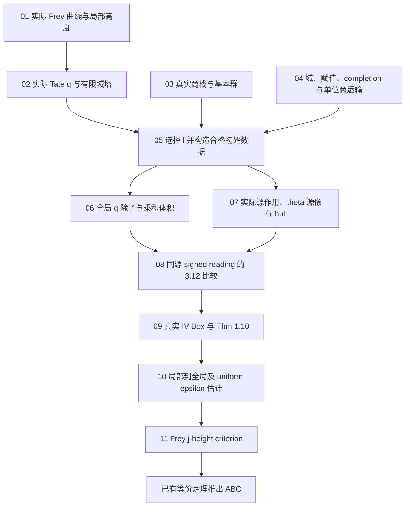

# P7 到 ABC：查重后的实际构造路线图

版本：2026-11-15，整合修订版。唯一正文文件：`coord/P7-GLOBAL-Q-HULL-CONSTRUCTION-20261115.md`。节点：`p7-global-q-hull-construction-20261115`。

本路线以实际数据为入口：从 abc 三元组构造曲线和合格初始 Θ-data，构造同源的全局 q 与实际 θ-hull，证明原 reading 的比较，再经真实 IUT IV 估计得到任意 ε 的 abc。主线不以 `hbound`、`hCor312`、`Nonempty` 或自由 compatibility 字段为终点。

本文按大审计索引查重，并定点核对关键源码。下文“已有”表示源码中观察到对应构造或证明，不表示本轮重编通过；条件供体与实际 producer 分开写。单线程，不编译，不修改 Lean。

## 1. 最终目标与依赖顺序

最终直接消费仓库已有的

`ABCEllipticHeightCriterion.abcConjecture_iff_freyJProductHeightCriterion`。

因此实际要产出的是：

\[
\forall\varepsilon>0\ \exists B_\varepsilon\ \forall(a,b,c),\quad
\operatorname{IsABCTriple}(a,b,c)\Longrightarrow
h(j(E_{a,b}))\le6(1+\varepsilon)\log\operatorname{rad}(abc)+B_\varepsilon.
\tag{T}
\]

B_ε 在三元组之前选定。已经形式化的 Frey-height/ABC 等价和 ε 的实数代数收口直接复用，不另建最终 wrapper。

为避免循环，02 中涉及 l 的域先作为参数化构造；05 选出实际 l 后实例化。05 的 prime avoidance、isogeny-height 和大像构造不得调用 08/09 的结论。

用户 A–G 清单在此图中的位置：A/B-q→06；B-θ/C/F→07–08；D/E→04；A2→03；WQuotient→04 的具体实例；abc assembly→09–11。它们不是七条互不相关的主线。

## 2. 查重结果：哪些不应再从零安排

| 已有供体 | 本次核对到的实际内容 | 本路线只新增什么 |
|---|---|---|
| `S3133RealifiedQPilotDivisorActual`、`S3133RealifiedQPilotLogVolumeActual` | 全局 q 除子、degree、与 qVFamily 局部 signed log 和的等式 | 加权真实乘积区域与原 reading 的接入 |
| `S3133QPilotReadoutActual` | Bad 参数化 q readout 及 normalized sum；完整 Q_C 部分有 prime-alignment 条件 | q-only 直接使用 qVFamily；完整 Q_C 再构造 alignment |
| `QPilotZeroLocusDivisorActual.qVFamily` | 同一 T 的 clause-B Tate comparison 参数 | 不再用 `BaseQFamilyActual` 的任意 DVR candidate 替代 |
| `Mzk1P3ProductHaarPiActual` | product Haar 与相对 log 求和 | 证明消费的实际区域是该 product/hull，并核准权重 |
| `Mzk1P3TensorCoreActual.tensorCore_fieldProduct` | actual tensor 自身的有限域乘积分解及维数和 | 使用它自己的因子，不寻找预选 root-product 等价 |
| `FinitePadicIntegralTensorLattice`、`FinitePadicSubmoduleTensor` | 完整 tensor 格、整基、紧开性、张成和映射 | 源 scalar/action 到该格或其 hull 的实际连接 |
| `LocalFieldIntegralHullSpan` | `integralSpan_subset_hull`；紧致非退化时 `integralSpan_eq_hull` | 有 provenance 的源生成元及其赋值/体积估计 |
| `NormalizedHaarTransport`、`LocalFieldProductLogVolumeTransport` | 连续加法等价下的相对 Haar 运输；hull 运输 | 实际等价实例和参考格修正 |
| `tmp/local-cft-port/PadicField/FieldNorm.lean` | `nrm_norm`、`v_norm`，后者指数为剩余次数 | actual completion/spectral norm/离散赋值运输 |
| `Example36GaussianSplitPlaceArithmetic`、`NormalizedLogNormComparison` | Gaussian 5-place 的 e=f=1、completion finrank=1、Integers=valuedInteger | 同源 place 对齐后构造 WQuotient 的显式同构 |
| `FreyTateAnalyticInput`、`ABCModelHeightComparison`、`ABCInvariantHeight/LocalHeight` | Frey j 的公式、局部估值、height 字典 | 不重算这些公式；补实际 Tate 参数的 producer |
| `FreyTateParameterComparison` | comparison packet 条件下的 q/j log-volume 与单位 residual | packet 本身的 q、certificate、j-match 与 norm 字段不能当已生成 |
| `TateUniformizationPointMap`、`TateUniformizationBaseChange`、`TateUniformizationPointMapReduction` | 点映射、base change，以及 injective/surjective 到两个坐标条件的归约 | 精确攻击 `tatePairCoordinatesSeparateOrbits` 和 `tateCoordinatesCoverNonzeroPoints` |
| `Example36CurveGaloisCategory`、`FiniteEtaleCoverFiber` | finite étale 覆盖的终对象、拉回、有限余积、补对象、纤维函子 | 一般有限群 quotient 的实际 descent、曲线/商栈实例及 Galois exact sequence |
| `PermutationTorsorQuotient`、`FiniteEtaleQuotientGluedCover` | `fixedPointsEquivOrbitFunctions`、轨道函数环有限 étale、局部商图、粘合的 descent/唯一性 | 实际 cover 的相容平凡化、有限性下降、完整 cocone/colimit producer |
| `S2020DicksonTransvectionActual` | l=5 的根子群、闭包生成与矩阵计算 | 泛化真正用于本路线的矩阵部分；实际 Galois 作用另造 |
| `S2835ImageContainsSL2Actual` | 从 Serre 大像假设搬到固定 arithmetic-37 basis | 不是实际大像 producer，不能用它消掉不可约性 |
| `GenEll16BelyiExistenceActual` | 有理/代数有限集的 polynomial Belyification | actual scheme map、所需非临界/指定值条件及高度接入 |
| `Mzk1BetaAvoidingFoldActual`、`Mzk1Consumer24AdapterUnconditionalActual`、`Mzk1Lemma22RationalGateActual` | rational 有限 β 的避让，rational restated 2.2 的构造 | 复用已完成归纳；分清有限 β、∞ 和 Qbar 的适用范围 |
| `Mzk1GeomCorePreciseToOldActual` | precise witness 到旧接口的转换 | 不重写 adapter；构造 precise 几何 witness，不能用旧自由 Prop |
| `Mzk1TruncatedUnitsPrimaryActual`、`Mzk1CongruenceUnitsEquivGeneralActual`、`Mzk1IutIVCongruenceCardActual` | 一般有限局部域的截断单位计数、同余单位商等价、`congruenceQuotientCardinalityInput_exists_actual` | 不再安排 B/A 重做；对齐实际 e/f、扭元 p 部分与最终 P14 公式 |
| `IutIVProp14GammaPGroupActual`、`Mzk1IutIVProp14ActualHBridgeActual` | 实际 Γ 是 p 群、`actualGammaH`；体积末端代数仍收指数/缩放等式 | 从现有计数和 Haar donor 交付这些实际等式 |
| `Section2.lean` | `iutIVProp21ii_theta_two_sided_eventually`、`iutIVProp16_index_le_four_thirds_nthPrime` 等已有证明体 | 选择阈值并处理有限例外；不再笼统派发“证明 PNT” |
| `Mzk1Ind1AlgebraicUnitQuotientActual`、`Mzk1Ind1UnitQuotientActual`、`IND1-UNIT-QUOTIENT-GAP.md` | abstract isoMon 的模挠作用及 log-range 后半段；连续性问题已有正确自然语言解法 | 实际有限局部域的单位子层及一般源箭头的限制/覆盖 |
| `StepV*Average`、`Mzk1BoxConstantAuditActual`、既有局部 hull bound | 平均、权重、常数与局部估计供体 | actual packet 的源识别和真实 Box 接线 |
| `ThetaBoundToHeightWeight`、`ABCEllipticHeightCriterion` | ε 系数吸收、actual Frey j-height 与 ABC 的等价 | 只交付实际高度/region 估计，不重做末端代数 |

另有两个不能按“字段已编译”处理的地方：`Mzk1A2PartialFieldsActual` 的 producer 使用退化 point stack；`SourceCompletionSignQuotient.unique_elliptic_involution` 当前量词包括 identity。03 给出真实对象的替换构造及中间语义修复办法。

## 3. 全线统一的读数规范

对同一源 T、同一 Bad 集 B，取 q_b=`qVFamily T b`，位于 F_b。记

\[
n_b=v_b(q_b)>0,\quad \#k_b=p_b^{f_b},\quad
 d_b=[F_b:\mathbb Q_{p_b}]=e_bf_b.
\]

固定以下字典，后文不再重新选择规范：

\[
|q_b|_{\rm mod}=p_b^{-f_bn_b},\qquad
|q_b|_{\rm abs}=p_b^{-n_b/e_b},\qquad
|q_b|_{\rm mod}=|q_b|_{\rm abs}^{d_b}.
\tag{D1}
\]

前者是 Haar 乘法模数，也是当前 `residueNormBase` completion 范数的公式；后者是 Qp-normalized/spectral norm。实际权重 w_b 给

\[
M_q=\sum_b w_b n_bf_b\log p_b,
\qquad Q_{\rm signed}=-M_q.
\tag{D2}
\]

`actualFn` 仅为 f_b，不含 n_b。hq 中只出现 `actualFn/Fdeg*log p` 的式子不能直接表示一般 q 大小；应从 qVFamily.order 加回实际重数，再核对 Fdeg 是否真为所需 normalization。

当前 `paperNormalizedQPilotSum=M_q`，`paperNormalizedThetaSum=M_q/(2l)`；其直接比较是根系数比较。j²/procession/hull 不在这两个 scalar 的定义里。根因子只在确实读取 `2l` 根时出现。

对区域 S 与同一参考满格 C，统一用

\[
V(S;C)=\log\mu(S)-\log\mu(C).
\]

若原消费者用另一个参考格 U，计算

\[
\kappa(C,U)=\log[C:C\cap U]-\log[U:C\cap U],\qquad
\log\mu(S)=V(S;C)+\kappa(C,U)+\log\mu(U).
\tag{D3}
\]

两个有限指数由实际基矩阵求出。不同 Haar 的整体倍数在 V 中消去；raw reading 的末两项仍须接回。θ 的 signed 读数不擅自改成 `-abs`。

## 4. 节点 01：实际曲线与局部高度

**输入：**任意正互素 a+b=c。**输出：**实际 E、j、坏位除子及精确高度字典，供 02、05、11 使用。

复用 Frey/ABC 供体，固定

\[
E:y^2=x(x-a)(x+b),\quad
\Delta=16a^2b^2c^2,\quad
j=256\frac{(a^2+ab+b^2)^3}{a^2b^2c^2}.
\]

已有局部证明处理奇素数 p|abc：c₄ 是 p-adic 单位，`−v_p(j)=2v_p(abc)`。已有 height 层处理

\[
\log(27/64)+6\log c\le h(j)\le6\log c+\log256.
\]

新增连接只有两项：把这些实际参数送入同一后续 Tate producer；把 p=2、extension degree、模型变化造成的局部修正留在明确的 divisor 中。不会再以 arbitrary q-candidate 实例启动 actual ABC 线。

## 5. 节点 02：实际 Tate q、点比较与根域

**已有部分：**j 的局部大小、Tate 系列/点映射、base change、坐标条件归约、comparison packet 的后半段。

**输出：**该实际 E 在相应 completion 上的 q、q-series certificate、实际 Tate comparison，及需要时的 root extension→K_v 嵌入。

### 5.1 先构造 q，不重新定义 q=1/j

在 contracting 盘中把 Tate 级数写成

\[
j(q)=q^{-1}+h(q),\qquad j(q)^{-1}=q+q^2g(q),
\]

其中 h、g 的适用整系数与收敛界从已有级数供体取得。给 t=1/j(E)，解 `q+q²g(q)=t`：在半径 r=|t|<1 的闭盘上用 `q↦t−q²g(q)`。整系数给 Lipschitz 常数至多 r<1；迭代得到实际唯一 q，并由非阿基米德主项给 |q|=|t|。

因此先得到所需 norm identity。`freyAbcTateCandidateQ=1/j` 可作同范数参照，不能当成实际 q 本身。

同 j 的两个曲线还须处理 twist。用实际 c₄/c₆ 和 Weierstrass 变量变换构造 isomorphism；若需有限扩张，实际添入变换系数并记录 degree。split multiplicative 分支再证明对应 descent，不从 j-match 单独推出点级比较。

### 5.2 精确补两个坐标条件

不重新开发 quotient bookkeeping，直接消费 `TateUniformizationPointMapReduction`：

1. **轨道分离。** 利用已有 q-periodicity，把 u、v 移到一个基本 annulus。在该 annulus 上计算 X(u)−x 的极点/零点：X 的原点极点阶为 2，非阿基米德 Laurent 展开及 Newton polygon/零点计数给两支，它们由 u↦u⁻¹ 交换。再用实际 Y 的反演公式分开两支；分支重合时按局部重数处理。由 X、Y 同时相同推出同一 q^Z 轨道。
2. **覆盖。** 给实际非奇异点 (x,y)，在基本 annulus 上用同一零点计数产生 X(u)=x；Y 满足 Weierstrass 二次方程。若第一支给另一根，用反演选回给定 y。局部 Weierstrass preparation/Hensel 把相应有限零点放进实际有限扩张；随后用 Galois 等变性下降。
3. **下降。** 对下降中的 lift u，若其点被 Galois 固定，则 `g(u)/u=q^n`；同一个绝对值下 |g(u)|=|u| 且 |q|<1，故 n=0。这样下降是实际元素的固定性证明，不是任取一个同构。

这两个坐标命题是新增分析节点；其他 Tate 点映射、Quotient 和 base-change 封装复用。

### 5.3 根进入指定 K_v

从实际 2l-torsion rationality 及同一个等变 Tate 商出发。取 α^(2l)=q，所对应 torsion 点在 K_v 有理；对 g∈G_{K_v}，`gα/α=q^n`，范数仍迫使 n=0，因此 α∈K_v。限制共同代数闭包上的嵌入到 F_v(α)，得到实际 root-field embedding。

只消费体积的分支可以暂不用这张根嵌入：若 L/F 是任一实际根域，r=[L:F]，则

\[
\frac1r V_L(\alpha O_L;O_L)=\frac1{2l}\log|q|_{\rm mod,F}.
\tag{R}
\]

因为 `[L:Qp]=r[F:Qp]`，根方程与 D1 即证。或者在已有 realified divisor 中使用 D_q/(2l)。这两种方法省去 volume 消费者的根下降，不能替代点级 theta/Kummer 来源。

## 6. 节点 03：A2 的实际商、基本群和相容 base change

**输入：**实际曲线 E 与原文穿孔/标记。**输出：**真实 `SourceSignQuotientData` 所消费的几何图。复用已存在 finite étale 类别和 quotient gluing，新增其实际实例。

### 6.1 固定实际 sign action 与商栈

取原文规定的开曲线 U，表示成其 étale 栈 X。群反演 [−1] 保持原点和 torsion 标记，限制到 U；平方为一和 action coherence 由同一个群结构导出。

令 G=C₂。直接定义商栈 C=[U/G]：对测试 scheme S，C(S) 的对象是 G-torsor P→S 与 equivariant map P→U。覆盖上的 torsor/morphism descent 给栈性质。

`OrbicurveSignQuotientWitness` 的字段按这个定义产生：invariant map 在 P 的平凡化上粘合给 `descend`；平凡 torsor 上计算给 `factor`；同一局部图下降 2-cells 给 `descendTwoCell`；étale descent 的唯一性给 factor compatibility 和 `twoCell_ext`。

保持 quotient stack 的稳定子，不能只取 coarse x-coordinate 商。穿孔、固定点和 orbifold signature 从实际 G-action 算出。

### 6.2 Galois category 不从零做：补当前 G2 的 producer

已有 terminal、pullback、有限 coproduct、clopen complement 和 geometric fiber functor。当前 G2 的实际构造按以下四步完成：

1. 对一个实际有限 étale cover 及其有限 G-action，取 étale 平凡化。局部代数为 R^I，作用成为有限集合 I 上的置换。
2. **直接复用** `PermutationTorsorQuotient.fixedPointsEquivOrbitFunctions`：`(R^I)^G≃R^(I/G)`，以及已有 `fixedPoints_finiteEtale_orbits`。不再证明“固定函数在轨道上常值”。
3. 重叠上的 equivariant transition 自动诱导轨道商的 transition，满足 cocycle。用已有 preglue/descent 组装 quotient；有限性、étaleness 从覆盖下降。
4. 用现有 `descOfCompatible` 与唯一性生成 cocone 的 IsColimit。这样得到实际 `HasColimitsOfShape (SingleObj G)`，而不是继续接受 `affineBaseG2` 参数。

### 6.3 从同一纤维函子产生 groups 与 inclusion

对 X、C 取兼容几何基点。定义 π₁ 为 finite étale 纤维函子的 automorphism group，拓扑由有限覆盖作用核给出。有限商逆极限给 profinite；在常值 field covers 上限制得到到 G_F 的投影。

实际曲线几何连通性保证常值覆盖的连接性质，有限层和逆极限相容提升给投影满射；base change/descent 识别其核为 geometric π₁。商栈图 U→[U/G] 是实际 finite étale G-torsor，因此给 π₁ inclusion 和到 G 的商。没有固定兼容基点时用基点路径记录共轭，不能直接假设 semidirect product。

把整张曲线/action/quotient/cover 图一起 base change 到 K。torsor 描述给 `[U/G]_K≃[U_K/G_K]`，由此定义 xK/cK 和 extension 字段，不独立选择四个对象再求类型相等。

### 6.4 修正 unique 中间字段的语义

当前量词 `∀inv, inv²≃id → inv=ellipticInvolution` 包括 inv=id。实施时应按消费者选一个正确版本：只需 sign action 就直接消费 canonical [−1]；确需唯一性则对保持原点的非恒等 involution 陈述。

其证明固定为：穿孔自同构唯一延拓到完备椭圆曲线并保持原点，因而为群自同态。`(σ−1)(σ+1)=0`；非零椭圆自同态是 isogeny，非零 isogeny 的复合非零，所以 σ=1 或 −1，非恒等分支给 −1。该中间语义修复与所有消费者一起重审，不能靠 point-stack 的 Subsingleton 填补。

## 7. 节点 04：局部运输与单位商——按同一张图构造

这些部分有明确构造，不再另列三条替代路线。

### 7.1 相对范数与 q contraction

固定 `RelativeNormCompletion` 的 actual completion algebra 和 scalar tower。复用 `PadicField.nrm_norm`：

\[
|N_{L/K}x|_{\rm abs}=|x|_{\rm abs}^{[L:K]}.
\]

先将其 spectral norm 与现有 Qp-normalized completion norm 对齐。若只证明 contraction，正 finrank 与 |q|<1 已足够，然后通过 norm/valuation 字典转回 `Valued.v<1`；无需等待完整值群公式。

要精确赋值时，复用 `PadicField.v_norm`：`v_K(Nx)=f(L/K)v_L(x)`。将两种离散赋值对齐的方法是先证明 valuation ring 相同，再用一个实际 uniformizer 的值 1 固定比例。模块绝对值于是满足

\[
\log|N_{L/K}q|_{\rm mod,K}=\log|q|_{\rm mod,L}.
\]

范数给的是实际除子推送，不是“原曲线的基域 Tate 参数”。q 体积消费者用推送即可；点/Kummer 消费者继续使用 02 的真正 descent。

### 7.2 Fmod 与 completion 的相容运输

已有 e:Fmod₁≃+*Fmod₂ 时，定义 transported prime/valuation，`v₂(x)=v₁(e⁻¹x)`。曲线、q、根方程、torsion 和整数环全部通过同一个 e 运输。这样 compatibility 由交换图证明，不从 RingEquiv 推类型相等。

对 moved valuation w'=w.comap σ，σ 满射给两边在 ambient Γ₀ 中的值域相同：一个方向是 `w'(x)=w(σx)`，另一个取 σ⁻¹ 的原像。先造保底层值的 range/order isomorphism，再运输阈值，不让大型 WithVal 实例用 rfl 整体归约。

从 `WithVal w'` 到 `WithVal w` 的底层 σ 满足

\[
w(\sigma x-\sigma y)=w'(x-y).
\]

对所有 x,y 使用同一个阈值，直接证明 UniformContinuous。σ⁻¹ 同理。completion universal property 给 `Completion.mapRingHom`；等式在稠密原域上验证，再由连续性延拓。这同时处理 `alignedCompletionMapMoved` 的交换图。

### 7.3 tensor 单位球不经过任意 tensor norm

对 actual decomposition `A≃∏E_τ`，其限制到第 i 个输入局部域的 map 是域嵌入 σ_{τ,i}，因此

\[
e(\otimes_i x_i)_\tau=\prod_i\sigma_{\tau,i}(x_i).
\]

x_i 对 Zp 整时，嵌入像、乘积及 Zp 线性组合仍整，故整个 integral tensor 格进入各因子的单位球。这里不要求任意基定义的 tensor sup norm 与乘法兼容，也不要求整个 e 等距。

一般 ramified unitLog 若只位于 `π_i^(−s_i)O_i`，把实际 s_i 带入赋值和 determinant；不把 Qp/Q2 的特殊界推广成所有域的 norm≤1。

### 7.4 Gaussian WQuotient 的实际 inhabitant

此处是一个具体分支，不把 Gaussian p=5 实例当一般 Ind1 箭头。

先用已有 finrank=1 和 rational completion≃Q5 得 K≃Q5；核对两份 Gaussian place 选择，相异时由 prime/valuation transport 对齐。用已有 `norm_integer_eq_valued_integer` 限制到整数环与单位，再由 `map_torsion` 下推商。

在 Z5ˣ 中，u⁴∈1+5Z5；principal log/exp 在 `1+5Z5↔5Z5` 上互逆。定义

\[
\Phi([u])=\frac1{20}\log(u^4)\in Z_5,
\qquad \Psi(z)=[\exp(5z)].
\]

log(u⁴)∈5Z5 且 4 是单位，所以 Φ 有值。Φ 的核为 torsion：log 单射给 Φ(u)=0⇒u⁴=1；反向由加法群无挠。ΦΨ=id；对 t=log(u⁴)/4，exp(t)⁴=u⁴，故 u/exp(t) 为四次单位根，给 ΨΦ=id。最后套 `Fin 1→Z5≃Z5` 与 Multiplicative wrapper。

若确切消费者只需 prime-to-5 可除性，可在实际 log 格 Λ 内乘 `(r^n)⁻¹∈Z5` 再拉回，剪去坐标化要求。

## 8. 节点 05：选择 l 与产生合格初始数据

**输入：**01–03 的实际 E、局部 q、有限塔/几何构造。**输出：**满足原文条件的实际 l、torsion 域、坏位、section、cusp 与 label 数据。不是额外输入 `LargeImage`。

### 8.1 公共的 prime-avoidance 部分

本节先处理原文固定 compactly bounded K_V 上的曲线，包含原文 p=2 的 j-bound；h 与 j-height 的 bounded discrepancy 在这个范围内证明。§13 负责解除这个范围限制，不能在本节直接声称已覆盖全部三元组。

设 h 为实际 normalized q-height，δ 控制固定 degree。按本地 IV Cor.2.2 的 P1–P3，排除：p≤√h；整除非零 h_v 的 p；等于 residue characteristic 且 h_v≥√h 的 p。

从 `Σh_v f_v log p_v=[F:Q]h` 分别界定排除集合的 `Σlog p`；使用已有 Section2 的显式 Chebyshev/素数供体，构造

\[
\sqrt h\le l\le10\delta\sqrt h\log(2\delta h),\qquad
l\nmid h_v\ (h_v\ne0).
\]

所有小 h 分支都保留可计算阈值，不假设其不出现。若 p∤2l 的乘法坏位为空，P3 给 h 被 √h log l 控制，从而 h 有界，也进入同一分支。

有这样的坏位时，Tate Kummer 作用与 l∤v(q) 给非平凡 transvection。大像的剩余要点是证明表示不可约。对这个把握较低的源节点，下面三条方法分别使用算术高度、有限 Frobenius 数据、模曲线几何。

### 8.2 S1：isogeny 与微分行列式高度（主线）

**构造对象：**stable 模型的 invariant-differential line、实际 l-isogeny φ:E→E'、其有限局部指数和 archimedean metric。

1. 若表示有稳定直线，实际构造相应 cyclic subgroup scheme 与 quotient isogeny；不是把“存在 isogeny”另收作假设。
2. 在每个乘法位，利用 l∤h_v 和 Tate 商检查稳定直线的类型。所需分支对应 μ_l，给 q_{E'}=q_E^l，故有限局部高度放大 l 倍。
3. 用实际微分格构造 Faltings-height 的 determinant line。φ 与 dual isogeny 的复合为 [l]，在各有限位给微分格指数受 v(l) 控制；在复位用 degree-l covering 的面积变化计算 metric。得到 isogeny height 差受常数倍 log l 控制。
4. 将 stable discriminant 的 12 次微分截面和复位 q-product/period area 对齐。在 cusp 用 Δ(q)=q∏(1−q^n)^24 与 j(q) 的已有级数界；在 fundamental-domain 的紧致部分给统一常数。证明 h_F 与 h(j)/12 的比较，并把 log(h(j)) 型误差吸收到一个较弱线性界，如 h_F≥h(j)/24−C。
5. 在当前 K_V 上，h(j(E)) 与 h 相差有界；而 E' 的 finite q-height 至少为 lh。以上上下界与 isogeny height 差合成原文所需

\[
\frac{l-2}{24}h\le2\log l+T_{K_V}.
\tag{S1}
\]

6. l≥√h 使这个分支 h 有界；其余分支表示不可约。共轭已有 transvection 得不同固定直线，二者生成两个根子群；复用 S2020 的矩阵证明并泛化到当前 l，得到 SL₂。

**复用界限：**GenEll06 是 statement ledger；不能当上述高度 producer。S2835 仅搬运大像假设。新增工作应集中在实际微分格/metric、isogeny 与 Tate 局部高度，而非再写 SL₂ 条件包装。

### 8.3 S2：Frobenius 的有限矩阵证书

**构造对象：**实际好约化位的点数、Frobenius 特征多项式、实际 torsion representation 中的矩阵。

1. 对好位 r 计数实际 E(k_r)，得到 a_r，并由 Frobenius endomorphism 的 degree/Weil pairing 计算 `X²−a_r X+Norm(r)`。
2. 为候选 l 证明其中一个多项式模 l 不可约。例如判别式是模 l 非平方。这个实际矩阵没有不变直线，因此整个表示不可约。
3. 与公共部分产生的 tame transvection 合成，直接得到 SL₂；不用 isogeny height 排除稳定直线。
4. 要将逐曲线证书变为 uniform producer，联合统计 prime-avoidance 坏集合和上述二次特征限制，证明某个好位/候选 l 在规定窗口内给证书。可先把窗口放宽为 `l log l=o(h)`，重新核算 IV 误差，避免无谓坚持原窗口的最优常数。

**第一项应证明的具体新命题：**从实际有限点数表，构造满足排除条件和不可约特征多项式的 l，并给统一高度成本。这里的量化素数分布是这一路线的主要研究工作；不能引用一个接受“存在合适 Frobenius”的 consumer 代替它。

### 8.4 S3：模曲线的有理点控制

**构造对象：**参数化 cyclic l-isogeny 的 X₀(l)、cuspidal divisors、Jacobian/Eisenstein quotient 及实际 specialization 图。

对 rational Frey 曲线，稳定直线给 X₀(l) 上的实际非尖点有理点。通过 q-expansion 构造 Eisenstein 关系、分析 cusp specialization 与 formal immersion，证明在足够大的 l 上不存在这样的点，或得到可控的有限 exceptional 家族。它直接给源曲线的 rational 不可约性，区别于 S1 的 Faltings-height 比较和 S2 的逐位 Frobenius 证书。

进入论文要求的小有限扩张 F 时，使用有限指数下降：若 rational image 含 SL₂，扩张使 image 的指数至多 δ，而 l>δ，则 SL₂ 的两个 order-l 根子群在至多 δ 个陪集上的作用都平凡，因而仍包含于 F-image。这里仅用陪集作用和根子群生成，不重新引用一般 Serre 大像定理。

若采用 §13 的 proper-cover/Belyi 全局化，输入曲线也会定义在次数≤d′ 的点域上；此时不能只用 rational-point 结论。将 closed points 送到 Sym^{d′}X₀(l)，以 gonality 排除低次数移动族，再对其 Abel–Jacobi 像做 cusp specialization/Eisenstein formal-immersion 分析，证明所需的 bounded-degree 排除或带明确高度上界的 exceptional 分支。仅证明 gonality 大并不排除孤立低次数点，后一步必须保留。若采用 §13.5 直接 Frey 路线，则 rational 版本加有限指数下降已经够用。

这条分支增加的基础对象最多；先落实 actual X₀(l) 点与 torsion subgroup 的双向字典，再证明对应次数范围的 cusp/Jacobian 命题。它以此几何论证替代 S1 的 isogeny-height 论证，不将一般 Serre/Merel 结论作为外部输入。

### 8.5 三路共同的完成步骤

得到实际 SL₂ 后，用其在 torsion vectors/lines 上的传递性构造所需 section、cusp、label/procession 图；K 取实际 l-torsion 坐标域，kernel identification 来自定义和 Galois 作用。剩余原文合格条件逐字段由 03 的几何图与同一 tower 填入，特别保留真实穿孔、非恒等 sign action、坏位范围；不从退化 A2 partial record 复制。

小高度/有限 exceptional 分支直接给 h(j) 的统一界，最终并入 B_ε，不使用 (T) 本身处理它们。

## 9. 节点 06：已有全局 q 的几何实现及 hq

**直接复用：**S3133 的全局除子与 signed 求和。**新增输出：**来自同一 T 的真实 global q region、精确 weighted readout，以及原消费者的对象字典。

### 9.1 有限乘积给实际对象

取

\[
X_q=\prod_{b\in B}F_b,\quad \mathbf q=(q_b)_b\in X_q^\times,
\quad C_q=\prod_bO_b,\quad J_q=\prod_bq_bO_b.
\]

`qTuple b := (qVFamily T b).q`，逆元逐坐标取 q_b⁻¹。不同 p 没有障碍；这里是乘积，Qp-tensor 才按 p 分组。

逐位以 uniformizer 过滤 O_b/q_bO_b，n_b 层每层有 p_b^{f_b} 个元素，故

\[
\mu_b(q_bO_b)/\mu_b(O_b)=p_b^{-f_bn_b}.
\]

套已有 product Haar：

\[
V(J_q;C_q)=-\sum_b n_bf_b\log p_b.
\]

正有限质量来自局部紧开理想。这个恒等式与 S3133 实际 divisor-degree 对齐，提供 object→reading 的通道；不是把希望得到的 scalar 定义成一个人工 q。

### 9.2 实际有理权重用重复因子实现

给来自 degree/procession 的 w_b，算公共分母 N，令 k_b=Nw_b∈ℕ。把第 b 个局部因子重复 k_b 次，得到真实 J_q^(N)、C_q^(N)，并证

\[
\frac1N V(J_q^{(N)};C_q^{(N)})
=-\sum_b w_b n_bf_b\log p_b=-M_q.
\]

如消费的是 abs norm 而非 mod norm，重复次数应按 w_b/d_b 清分母。一般实化权重则在已有 realified divisor 上取 degree，不声称它都能变成整数次重复。

本路线不需要数域中的全局 principal generator。原文 Definition 3.8(i) 的全局 Frobenioid 对象由 q_v 族确定，局部为理想/线丛；已有 S3133 正是可复用的对象层。

### 9.3 只比较体积时的 determinant 实现

若上游是 tensor 格，取实际整基矩阵 M_i。对 d_i=dim V_i、D=∏d_i，Kronecker determinant 给

\[
\frac1D V(\otimes_i\Lambda_i;\otimes_i C_i)
=\sum_i\frac1{d_i}V(\Lambda_i;C_i).
\tag{Qdet}
\]

整基与 full tensor lattice 已有，新增实际 M_i 及其 determinant 计算。不同 carrier 经各自 determinant line 和 degree 比较，无需 tensor≃预选 root-product。换到另一参考格仍按 D3 计入 κ。

### 9.4 接回原 reading 的规则

旧 `C3.q` 是一个局部元素，全局 packet 的投影才是相应 q_b。因此接线是局部投影与有限 weighted aggregation，不证明一个独立 C3.q 的 log 等于任意全局和。

如果当前锁定入口把全局论文 reading 定义成单点 log，就登记语义修复：全局入口取真实 packet，旧 C3 保留为局部实例，并一起重验其消费者。这个修复不改论文不等式；本路线不以“新全局 theorem 已证”冒充旧单点类型自动验收。

## 10. 节点 07 的源端：实际 Ind1/Ind2、procession 与覆盖

本节点交付的是源箭头的实际作用；“存在一个同维线性等价”不是它的替代品。下界可以先用有限个已构造箭头，上界则必须控制论文允许的全部箭头。

### 10.1 先固定已经可证明的后半段

设已经从源得到 β：W_F≃W_F′，其中 W_F=O_Fˣ/tors。已有 log-kernel、深层单位 log 同构和有限指数定理说明 W_F 是有限秩自由 ℤₚ 模，log 给到实际 log-lattice 的同构。一般 ramified case 不必要求 log-lattice 等于 O_F；选择它自己的整基即可。

这里应保留仓库文档的最新更正：在标准拓扑的有限秩 ℤₚ 模之间，抽象加法群同态确实自动连续。证明只有

\[
\beta(p^nW_F)\subseteq p^nW_{F'}
\]

和 pⁿW 的邻域基性质；逆同态同理。再由整数作用、ℤ 在 ℤₚ 中稠密、连续性得到 ℤₚ 线性，局部化得到 ℚₚ 线性。不能把“任意拓扑群抽象同态自动连续”推广进来，也不应继续为这一有限秩情形安排 wild-map 障碍。

于是后半段直接消费现有 unit quotient/log-square/shell 供体。源端尚不确定，保留以下三种机制不同的构造。

### 10.2 D1：Galois 不动点与 degree-zero 子层（优先）

这一条最贴近已有 FPrimeStrip 数据，**不要求从单位群恢复整个域加法**。

1. 把每个实际有限局部域 F 嵌入同一个对应 p 的代数闭包。记 H_F=Gal(F̄/F)。源码的 concrete Mon 为 F̄ˣ，其 degree 是 log norm。
2. 在 Mon 内定义真正的有限域单位子层
   \[
   U(H_F)=\{x\in\bar F^\times:\ h(x)=x\ \forall h\in H_F,\quad
                         \deg(x)=0\}.
   \]
   Galois 不动域定理先将 x 降到 F；degree=0 等价于 ‖x‖=1，因而 x 与 x⁻¹ 都在 O_F。由此构造 U(H_F)≃O_Fˣ，不把整个 F̄ˣ/tors 与 W_F 等同。
3. 对实际 FPrimeStrip 箭头 a，compatAction 和 compatDegree 分别保证不动性和 degree-zero 被保持。若 H_F 在 source 的实际 finite-cover 对应下送到 H_F′，直接限制 isoMon，得到 O_Fˣ≃O_F′ˣ，再模挠得到 β_a。交换图由限制定义逐元素证明；复合与逆的律也由限制得到。
4. **一般 DPrime 箭头的覆盖在此处证明。** 从 03 的实际 finite étale 纤维函子出发，把 Mon 呈现成带 degree、cyclotomic line 和 Galois 作用的源构造；对源箭头的每个生成操作构造此呈现上的自然变换，证明其关系也成立。然后按原文对允许箭头的生成/分解证明，将任意允许箭头逐步提升。对 finite cover 的稳定子直接证明 a(H_F)=H_F′；不用自由的“open subgroup preserved”字段。
5. 若原文箭头不是由当前代码列出的生成元定义，先对原文的实际函子证明每个箭头诱导上述自然变换，再使用生成元计算；不能反过来把 allowed arrows 改成已会提升者的像。

**第一个具体产物：**在 concrete Mon 上证明 fixed_degreeZero_units_equiv，并对一个实际非平凡 procession 箭头给出 restriction commuting square。其成功不依赖 3.12 或 Haar 下界。真正研究量集中在第 4 步的源函子提升与覆盖。

### 10.3 D2：有限 Kummer 层、Hilbert 90 与逆极限

这一条直接重建单位的有限商，不先构造 algebraic-closure Mon 的全局同构。

1. 对每个 n 使用实际连续 Galois cochain，写出
   \[
   1\to\mu_{p^n}\to\bar F^\times
      \xrightarrow{p^n}\bar F^\times\to1.
   \]
   幂映射满射由代数闭包中取根。当前 KummerGaloisClass 只有注入/核层，不能把满射当现成供体。
2. 补 Hilbert 90 的实际证明：有限 Galois 层上的 cocycle c_g，选 t 使
   \(\sum_g c_g g(t)\ne0\)，非零 t 的存在由不同域自同态线性无关得到；直接计算其 Galois 作用，写成 coboundary。连续 cocycle 经有限扩张下降处理。长正合序列或同样的显式 cocycle 算法给
   \(F^\times/(F^\times)^{p^n}\simeq H^1(G_F,\mu_{p^n})\)。
3. valuation mod pⁿ 的核就是 U_F/U_F^{pⁿ}：若 v(x)∈pⁿℤ，除去一个 uniformizer 的 pⁿ 次幂后取单位代表。源箭头在 Galois、cyclotomic line 与 valuation/cusp 数据上的实际相容性，诱导这个核上的 β_n。
4. 对 transition n+1→n，检查 cocycle 取幂与 reduction 交换。取逆极限；实际 U_F 紧致且 p-primary completion 可由单位滤过描述，有限 prime-to-p torsion 被消去，p-primary torsion仍需显式模掉。得到
   \[
   W_F\simeq\left(\varprojlim_n U_F/U_F^{p^n}\right)/\text{其有限挠子群}.
   \]
   两边的映射先在单位上定义，再用深层 log 同构证明单射、满射及拓扑一致性。
5. 对每个原文 source arrow 从其在有限 Kummer covers 上的作用构造 β_n，证明逆极限同构的复合律。覆盖问题变为“每个允许箭头是否自然作用于这一整套有限 covers”，由源范畴实际 functor 验证，不能只验一层 n=1。

**第一个具体产物：**真实 U_F/U_F^p 上的满射 Kummer 字典及某个非平凡箭头的相容图。它与 D1 的区别是 cohomology/有限商重建，不要求先提供 isoMon。

### 10.4 D3：局部 reciprocity 与惯性像

这一条从 Galois 端恢复单位，证明机制是范数群和 reciprocity。

1. 在实际 F 上构造 local reciprocity，而非调用一个未实例化的 LocalCFT 接口。可采用 Lubin–Tate：选 uniformizer π，递归构造以 π 为线性项、模 π 为 q 次 Frobenius 的形式群自同态；逐层添 torsion，得到单位对 torsion 塔的作用。未分歧塔上的 Frobenius 补出 π 的像。
2. 用形式群 torsion 的阶、Eisenstein 多项式和范数关系证明有限层 reciprocity；再用有限 abelian 扩张的范数指标定理证明覆盖所有有限 abelian 商。后一步是此路的主要证明工作，不能由“已有局部域”四字略去。
3. 对实际 reciprocity 映射证明 U_F 的像正是 G_F^ab 中的惯性像，且两者在 pro-p 部分取有限挠商后相同。用未分歧扩张的 valuation/Frobenius 描述证明 kernel，使用 principal-unit 滤过证明拓扑。
4. 实际 DPrime 箭头经 abelianization 得到惯性像之间的映射。由原文惯性/cusp 数据的源定义证明它保持这一子群，然后经 reciprocity 搬回 β_a。如此全覆盖来自每个 source arrow 对惯性数据的函子性，不来自 K-automorphism 的恒等例子。

**第一个具体产物：**一个实际有限层的 unit_norm_quotient≃inertia_quotient，及其对指定源箭头的自然性。D3 代价最大，作为 D1/D2 的独立替代机制保留；不与前两路共用同一个未证“unit realization”黑箱。

### 10.5 procession、theta-label 和 multiradial 的实际数据

直接复用 S3139SourceMultiradialQuotientActual 与现有 mutation inhabitant；不再重造 quotient carrier/map。补三个 residual 数据时遵循同一源图：

- **ProcessionCapsule：**从实际 torsion 基和源 cover 取标号集合，procession 定义为标号的实际序列及 transition。相同几何对象的不同标号是不同 presentation；转换由实际置换/源箭头给出。
- **LGP：**每行由实际 completion tensor、unit-log 格、theta 的级数/根表达式组成；将这些组成 dependent tuple，再按已经证明的 transition 下降。不能给 thetaValue_compat 赋 True，要逐坐标写出两个求值映射相同。
- **Fmod real embedding：**从实际 divisor 的次数和实化得到 degree map；若需要 archimedean embedding，取实际域嵌入并用共轭/乘积公式证明最终平均与选择无关，不能直接塞一个实数表。
- **label：**若每个坏位有多个合法 theta labels，就先用带 label 的 cover \(\widetilde B=\{(b,\lambda)\}\) 做构造，再按实际 fiber-degree 权重下降到 B。证明更换 torsion 基只置换 fibers、归一化总和不变。这样不强求一个没有几何依据的 HeightOneSpectrum→ProcessionLabel canonical 函数。
- **residue-one：**主线保留实际 f_b 与相对 f，不先设成 1。消费者若字面要求 f=1，先证明其指定 tame/split source 处的 residue map 是同构：定位实际 prime fiber、用分解群作用或 Hensel 分解得到 degree-one 因子，再接已有 localResidueDegree_eq_one_of_residueFieldEquiv。若实际 source 未具有该性质，则使用带 f 的局部估计重做其平均，不把一般 f=1 新增为假设。

## 11. 节点 07–08：实际 θ-hull 下界与 3.12 的三种构造

### 11.1 三条路线共享的准确对象

对同一 source、同一 prime p、同一 procession 行 t，取 actual tensor A_t。复用它自己的分解

\[
e_t:A_t\simeq_{\mathbb Q_p}\prod_{\tau}E_{t,\tau},
\qquad O_t=\prod_\tau O_{E_{t,\tau}}.
\]

令 S_t 为该行所有合法源像，H_t 为原文 integral holomorphic hull；参考满格 C_t 由实际 tensor unit-log 格送入该 carrier。已有积分 hull/span 供体说明：对有限真实源像 G_t⊂S_t，

\[
\Gamma_t:=O_t\cdot G_t\subseteq H_t.
\tag{H0}
\]

有紧致非退化证据时可进一步等同 full span 和 hull；**下界只需 (H0)，不必等所有 possible images 的分类。**正有限测度来自实际满格与共同有界容器；没有 spanning 的有限 G_t 只能给零测度子空间，不足以取 log。

按 06、原文 root 系数和实际 weights 计算 q reading Q。目标是证明

\[
Q\le\sum_t a_t\,V(H_t;C_t)+\text{原 reading 的参考格修正}.
\tag{H}
\]

a_t 必须来自原始 procession/fiber average。一个 H_t 内可以从不同合法源像分别取各坐标最优值；不同 t 的 hull 不能先并在一起、再把更大的体积冒充原来的平均。

### 11.2 H1：积分环饱和与逐坐标最小赋值（主线）

**构造。**每个因子 τ，选有限实际源向量 \(g_{t,r}\in S_t\)，并计算

\[
r_{t,\tau}=\min_r v_{t,\tau}((e_tg_{t,r})_\tau).
\]

零坐标取赋值 ∞；每个 τ 至少一个非零值。由 product ring 的幂等元分离坐标，DVR 中有限元素生成的理想由最小赋值元素生成，所以

\[
\Gamma_t=\prod_\tau \pi_\tau^{r_{t,\tau}}O_{E_{t,\tau}}.
\tag{H1a}
\]

这正是绕过“pure tensor 像不是 product box”的办法：保留真实 pure tensor 集合，取原文本就允许的 O_t-hull。无需证明 pure tensor 集合本身是盒子，也无需找到 root-product 与 tensor 的同维等价。

**体积。**先对 O_t 计量：

\[
V(\Gamma_t;O_t)
 =-\sum_\tau f_{t,\tau}r_{t,\tau}\log p.
\tag{H1b}
\]

再用 (D3) 换到 C_t，并除以原文要求的 finrank/权重。任何 finite saturation gain 都是实际指数
\(\log[O_t\Lambda_t:\Lambda_t]\)，不允许凭空取一个“需要多大就多大”的修正。

**寻找源向量的办法。**

1. 从已经存在的 q-root、theta 功能方程、单位 log 格基生成第一批列；theta 的 leading term 及 residual unit 给每一坐标实际赋值。
2. 对这些列施加 10 已证明合法的非平凡箭头，记录其 effect：置换、单位矩阵、允许的格自同构或实际 finite-cover transport。只使用有 source 证明的操作。
3. 对每个 τ 选赋值最小的一列。选取可以依赖 τ，不要求同一个向量在所有 τ 同时最优；因为 O_t 幂等元已经在允许 hull 操作中。
4. 用根阶、different 和单位 log 指数计算 H1b 的总预算，再用 distinguished-slot 和 procession 的已证平均公式求和。把获得的最小赋值写成明确的 j、n_b、e、f 表达式，再以平方和/排列计数证明 (H)；不把该预算写回新输入。

例如在同一合法 hull 中若实际得到
\(g_1=(p^a,p^{a+N})\)、\(g_2=(p^{a+N},p^a)\)，则它们的 \(\mathbb Z_p\times\mathbb Z_p\)-span 是 \(p^a\mathbb Z_p^2\)。两个向量分别在不同坐标补足弱项。这个例子说明如何利用重排扩大真实 hull；**项目中是否有对应合法置换，需要由源 action 验证，例子本身不充当证明。**

**首个可检验产物：**选择一个真实非平凡 packet，列出源向量—因子坐标—赋值三列表，证明其 span 包含式；然后将表泛化为由实际 labels 参数化的公式。若最小赋值预算不够，明确找新的合法源像/饱和增益，或转 H2/H3；不能只将预算命名为 hbound。

### 11.3 H2：行列式理想与整系数 theta 关系

H2 不靠每个坐标各自找到最优向量，而是寻找**源向量之间的代数关系**。

1. 清除实际有理 weights 的共同分母，重复对应因子；选择实际参考整基。满格 Γ_t 的 determinant ideal 由源矩阵的满秩 minors 及 O_t 作用产生的列生成。q-side 在同一 determinant line 给一个实际分式理想 I_q。
2. 比较转换为
   \[
   I_q\subseteq I_\Gamma.
   \tag{H2a}
   \]
   小理想的 Haar 体积小，方向恰好是 signed lower bound。若局部逐 p 包含太强，则保留全局 arithmetic degree 比较及已算出的局部误差。
3. 寻找如下**具体恒等式证书**：
   \[
   z_q=\sum_I c_I\det(M_I),\qquad c_I\in\mathbb Z_p,
   \tag{H2b}
   \]
   其中 z_q 是实际 q determinant generator，M_I 来自真实源列。可以先对极小 label 集做 theta addition/multiplication identity，展开 leading q 次数，再确定 determinant 的单位主项。
4. 用 Cauchy–Binet 处理源作用复合，用 Kronecker determinant 处理 tensor，用 exterior power 处理 degree 权重。theta 恒等式从已有收敛级数或其形式幂级数逐系数证明，再代入 actual q；积分性由实际系数和 residual units 验证。
5. 若系数只有 J⁻¹ℤₚ，先得到 \(J I_q\subseteq I_\Gamma\)，将其明确的 valuation 损失留在真实 different/exceptional 预算，证明该预算可被 IV 的现成项容纳；不把 J 删除。

**首个可检验产物：**一个由实际 theta/source columns 组成的非零 minor，及其 leading coefficient 是单位的证明；再给 q generator 的整系数组合。H2 的胜点是代数关系能认证所需 determinant 属于源生成理想；它不是允许随意相消得到更低赋值——非阿基米德三角不等式仍然适用。

### 11.4 H3：有限 Fourier 对偶与支撑下界

H3 改用有限 harmonic analysis 的支撑不确定性，数学机制不同于饱和最小值和 determinant 恒等式。

1. 在实际非退化 packet 中，找满格 \(C_-\subseteq H_t\subseteq C_+\)，取有限加法群 \(G=C_+/C_-\)。下层可由已构造源满格取得，上层由已有 IV 容器取得。用 trace pairing 与 codifferent 明确构造 G 的对偶；different 是对偶格的真实因子。
2. 从实际 finite Kummer pairing、theta group 和源 line bundle 的 sections，构造有限 Heisenberg 群及其 Schrödinger 表示。给出一个**非零**向量 f∈ℂ[G]，使其支撑 A 的每个类都在 actual hull 的像中。
3. 计算 q-side 的 Kummer 周期/特征给 f 的平移规律
   \(f(x+h)=\chi(h)f(x)\)。逐项 Fourier 求和可直接证明 \(\widehat f\) 的支撑位于由该 χ 确定的 annihilator coset B。B 的阶从实际周期子群指数算出，并与 q determinant/Haar 质量对齐。
4. 有限 Fourier 的 Plancherel 与 Cauchy–Schwarz 给
   \[
   \#A\,\#B\ge\#G.
   \tag{H3a}
   \]
   证明可直接写：在 Fourier 反演中以 B 限制求和，用 Cauchy–Schwarz 控制 \(\|f\|_\infty\)，再用 \(\|f\|_2^2\le\#A\|f\|_\infty^2\)。计数取 Haar 陪集体积，得
   \[
   \mu(H_t)\ge\#A\,\mu(C_-)
       \ge\frac{\#G}{\#B}\mu(C_-).
   \tag{H3b}
   \]
5. actual Kummer 的周期指数若使最后一项达到 q-side 的目标质量，就得到 (H)。对 weights 同样先重复有限群、最后除公共倍数，codifferent 修正显式计入。

这条路线**不是把任意 p-adic theta 值嵌入 ℂ**。ℂ 只承载有限 roots of unity 的 character；f 必须来自实际 finite theta-group 表示及源 section。随便取 indicator function，或先假设 Fourier 支撑足够小，都会把难点藏起来。

**首个可检验产物：**实际源 quotient 到有限 Heisenberg 表示的 intertwiner，连同一个非零向量的平移特征。主要研究点是这些特征是否提供足够的 q 周期，而非有限 Fourier 不等式本身。若不同 n 的有限近似都要用，还须证明 transition 相容和陪集体积收敛；不能只展示一个有利的玩具有限群。

### 11.5 三路如何交付原 reading

H1/H2/H3 任一得到的首先是同源真实区域的 signed 体积。最后顺序固定：

1. 用 06 的 global q 实际对象证明其 reading 等于精确 weighted log sum。
2. 用实际 region、field-product 分解及相对 Haar 运输证明 θ reading 等于所算体积；乘积 Haar 的未知整体倍数通过同一参考格抵消。
3. 对 legacy raw reading 加回 (D3)，核实 unitMass 与 root/degree 因子。有限域塔用实际 finrank 乘法式；不再要求旧额外关系 d_F=m·B，除非该 B 的定义确由同一塔给出。
4. 由区域包含或上述证书推出 q-reading≤θ-hull-reading。若 θ-hull 的 signed log 为正，也原样保留；不能用 thetaNormReadL=−thetaNormReadProduct 这种没有定义依据的符号翻转。

因此不需要把 tensor 与预选根域乘积作代数等价、不需要把两个不相关 unitMass 证明为 1，也不需要 principal global q。需要的是**同一个实际对象图里的读数同一化和一个真实下界证明**。

## 12. 节点 09：Prop 1.4、qhat Haar 与真实 IV Box

### 12.1 Prop 1.4(ii)：复用已完成的有限商计数，补实际公式拼接

取实际有限扩张 K/ℚₚ，O=O_K，U=Oˣ，T=tors(U)，q=p^f，d=[K:ℚₚ]，e=v_K(p)。令 s=1（p≠2）、s=2（p=2），

\[
U_s=1+p^sO,\quad L=\log U,\quad
\Lambda=p^{-s}L,\quad\Gamma=\Lambda/O.
\]

以下证明链已有相当部分；按实际对象调用它们，不重新派发分析或计数任务。

1. **精确序列已有。** 深层 log 给 U_s≃p^sO，ker(log)=T，T∩U_s=1，因此
   \[
   1\to T\to U/U_s\to\Gamma\to0.
   \]
   若 log(u)∈p^sO，用深层 exp 选 v∈U_s 且 log v=log u，再得 uv⁻¹∈T，证明核识别。IntegralLogShellIntegerQuotient/IndexArithmetic 已实现这段。
2. **同余计数的新旧状态已改变。** 当前 Mzk1CongruenceUnitsEquivGeneralActual 已给一般实际
   \(U/U_s\simeq(O/(p^s))^\times\)；Mzk1TruncatedUnitsPrimaryActual 给
   \[
   \#(U/U_s)=(q-1)q^{es-1}.
   \]
   Mzk1IutIVCongruenceCardActual 已把两者组装成 actual cardinality producer。早先“B/A 尚未完成”的清单不能继续直接使用。数学依据是 DVR 的 (p^s)=m^{es}、商环有 q^{es} 个元素、非单位恰好 q^{es−1} 个；现阶段直接 import 这些证明体。
3. **Γ 的 p 群证明也已有。** 每个代表元 z 乘足够高 p 次幂进入 O，故 Γ 中每个元素被 p 幂杀死。Γ 有限，IutIVProp14GammaPGroupActual 给 \(\#\Gamma=p^h\)，Mzk1IutIVProp14ActualHBridgeActual 已构造实际 h。
4. **把 m 与原文实际扭元对齐。** 取有限交换群 T 的 p-primary 部分，定义其阶 p^m。由精确序列
   \[
   \#T\cdot p^h=(q-1)p^{f(es-1)},\qquad p\nmid(q-1)
   \]
   得
   \[
   \#T=(q-1)p^m,\qquad h+m=f(es-1).
   \tag{P1}
   \]
   这里取 p-adic multiplicity/有限群 Sylow 阶，并接 Nat.card；不假设 T 恰为 residue units，不假设 m=0。
5. **d=ef 使用现成塔公式；必要时同源计数直接证。** O/pO 有 q^e 个陪集，故 μ(O)=q^eμ(pO)；现有 Qp-向量空间 Haar 缩放给 μ(pO)=p^{-d}μ(O)。消去正有限质量，得到 p^d=p^{ef}，故 d=ef。这个缩放定理按向量空间维数建立，不用 d=ef，因此无循环。
6. **计算真实质量。** IntegralLogShellHaarIndex 给 μ(Λ)=p^hμ(O)；FinitePadicHaarScaling 给 μ(L)=p^{-sd}μ(Λ)。代入 P1：
   \[
   \boxed{\frac1d\log\frac{\mu(L)}{\mu(O)}
     =-\left(\frac1e+\frac m{ef}\right)\log p.}
   \tag{P14}
   \]

新增任务是实际 e/f/扭元参数的识别与这一串调用，不能把 h+m+f=sd、μΛ/μO 或 μL/μΛ 又放回最终结论的输入。特别注意 L 与 integralLogShell Λ 相差 p^s，后者的非负 discrepancy 不能直接当成前者负的 log-volume。

### 12.2 qhatHaarScaling 的单一路线

复用 Mzk1P2QNativeSourceArrowActual 中 p2QHat_norm_eq_qVFamily_norm。然后证明**实际乘法映射的 Haar 模数**：

\[
m_\alpha:x\mapsto\alpha x,\qquad
\mu(m_\alpha S)=|N_{K/\mathbb Q_p}(\alpha)|_p\,\mu(S)
             =|\alpha|_{\rm abs}^{d}\mu(S).
\tag{QH}
\]

实现上对 O-格用 index/valuation 算 μ(αO)，再由 Haar 唯一性推到可测 S；或者在已有有限维缩放接口下计算乘法线性映射的 determinant。不可把标准谱范数 |α| 直接当作 d 维 Haar 模数。

α 若为 q 的 2l 根，其范数来自根方程；若 qhat 与 q 相差实际单位，单位乘法使 O 双射到 O，所以模数为 1。若 qhat transport 含单位商 action，使用该 action 对**自己的实际 log-lattice**的同构，再按相对 Haar transport 消去常数。这样 qhat scaling 由同一实际 arrow 导出，不需要假设两个独立 Haar 的 unitMass 相等。

### 12.3 Step V 所需的局部上界

原文 Step V 可以用 1.4(iii) 的共同容器上界，不必等待每一处 (ii) 的精确 m 数值。按现有 Prop14Lattice/局部 hull bound 证明体提取如下内容：

1. 对实际 tensor 的整格与 trace-dual 格，利用 different 构造夹逼容器；把 source shell 的各列送入这个容器。
2. 对**全部实际允许作用**证明该容器稳定或具有指定明确缩放。这里消费 §10 的覆盖/格作用；只证明 tensor algebra automorphism 不足以自动覆盖原文一般 lattice action。
3. distinguished ϖ 用真实根式 \(\alpha^{j^2}u\)、u 为单位，推出
   \(v(\varpi)=j^2v(q)/(2l)\)，在统一绝对值/ord_p 字典下换算。
4. 使用共同容器求 Haar 上界，保留 different、ramification 与 exceptional 项。若某个现成 shell 版本额外产生一个 slot 误差，优先沿其证明重用共同容器，不把多出的误差宣称已吸收。

阿基米德部分从实际 embedding 的 Hermitian tensor norm、Gram determinant 和格协体积计算；换基 determinant 和 degree 平均显式进入 S/T 项。已有 Prop1.5/E1–E6 相关供体直接接用。小素数/Chebyshev 方面当前 Section2 已有双侧最终界和 prime-index 界；只在原文消费者要求具体阈值而现有 theorem 给存在阈值时，单独交付该阈值或把其以下有限区间纳入统一常数。

### 12.4 S1902 与 Thm 1.10 的实际接线

按一个 actual packet 完成以下链，禁止从独立来源各取一个同名字段拼成非交换图：

1. K_{v_i} 从 02/05 的同一 K 与 prime 构造；S1902 carrier 通过自己的 tensor 分解/参考格与 packet 连起来。
2. 给 PacketHullData 填实际 factor fields、istar、ϖ、Φ、different generators、exceptional 标记及作用族。不同理想生成元的选择由单位不变性消去。
3. 消费 arithmeticTuple_stepV_hull_normalizedLogVolume_le_paperBound / packetHull_normalizedLogVolume_le_box，得到同一个 hull 的 signed 上界。
4. 用 StepVDistinguishedSlotAverage、StepVDivisorAverage、StepVProcessionAverage 完成索引和 fiber-degree 权重；逐项证明每个实际 b/label/slot 计数正确，先 Fubini/reindex，再用平方和公式。
5. 得到原文的
   \[
   R\le\frac{l+5}{4}D-\frac{l+1}{24}Q+S+(l+5)T.
   \tag{IV}
   \]
6. 将 §11 的原 reading 比较按同一字典代入，构造 actual Thm110DisplayTerms，随后调用现有展示式代数。logQ bound 在这里由 3.12 得到，不再作为自由输入。

项目 surrogate \(l(\log d+\log f)/4+C_0\) 不进入此主线。其 disc=cond=1 的常数问题不必作为证明真实 IV 的先决任务；真实 IV/高度线中的有界小高度 case 由统一常数处理。这样剪掉的是不必要的中间 surrogate，最终目标 (T) 的量词和系数不变。

按照原文 Cor2.2 选 l、处理 different/exceptional 项后，目标具体整理成

\[
\frac{h}{6}
 \le (1+\delta h^{-1/2})R
       +C\,\delta^2\sqrt h\log(2\delta h)+C_K,
\tag{IV'}
\]

其中 h 是同一实际曲线的归一化有限位 q-height，R 是其 log-different/conductor，C、C_K 与当前点无关。要由真实 IV 的系数推出 IV′；不是把 IV′ 再包装成一个新的条件 theorem。

## 13. 节点 10：从 compactly bounded 情形到全局的三条路线

这里不能略去原文 Cor2.3。IV′ 中的 h 是实际有限位 q-height；在选定 K_V 上，它才与 j-height 相差有界。p=2 或 archimedean 的 q/j 项不能对所有三元组都当成同一个常数。

本节点的 G1/G2 是两种不同的实际 noncritical map 构造，接同一个紧性论证；G3 则改建比较定理的适用域，绕开这套全局化。G1 最贴近已有成果。

### 13.1 G1 的第一步：用具体 Fermat 覆盖消去边界

针对最终的 rational abc，不必先实现任意 hyperbolic curve 的覆盖存在定理。对 X=ℙ¹、D={0,1,∞}，取固定 n≥4，

\[
Y_n:\ X_0^n+X_1^n=X_2^n,\qquad
\pi:Y_n\to\mathbb P^1,\quad
\lambda=X_0^n/X_2^n.
\]

这是实际光滑 proper 曲线；Jacobian 判据证明光滑，函数域或三个 affine charts 证明 degree=n²，在三组 boundary points 的 ramification index 均为 n。Riemann–Hurwitz 给

\[
2g(Y_n)-2=n(n-3),\qquad
\#E=3n,\qquad
\frac{\deg\omega_{Y_n}(E)}{\deg\omega_{Y_n}}
  =\frac n{n-3},
\quad E=(\pi^{-1}D)_{\mathrm{red}}.
\tag{G1a}
\]

选择 n 使最后比值接近 1。每个 λ=a/c 实际提升为
\(((a/c)^{1/n},(b/c)^{1/n})\)，点域次数≤n²；取根域是实际 splitting/adjoin construction。

**不同与 conductor 的控制也要构造。** 在不整除 nabc 的素数，方程为单位的 n 次根扩张且 n 可逆，有限 étale，因而不分歧。在 p|abc、p∤n 处是 tame，归一化 different 贡献≤log p。在固定 p|n 处，先将 radicand 的 valuation 模 n 约化，再用实际局部不同上界控制，损失只依赖固定 n。得到

\[
\log\mathrm{diff}(k(y)/\mathbb Q)
 \le \log\operatorname{rad}(abc)+C_n.
\tag{G1b}
\]

height 由 \(\pi^*\omega_X(D)=\omega_Y(E)\) 接回。比较正次数线丛时先留严格 degree 余量：使
\((1+\eta)\omega_Y-\omega_Y(E)\) 仍有正次数，用它的高度有下界推出
\(h_{\omega_Y(E)}\le(1+\eta)h_{\omega_Y}+O(1)\)。
不把“同次数线丛的高度差”擅自说成有界。

因此只需在固定 proper hyperbolic Y_n 上证明任意 ε 的
\(h_{\omega_Y}\le(1+\varepsilon)\log\mathrm{diff}+C\)。
覆盖的 n、degree、坏素数及所有常数都在当前 abc 三元组之前选定。

### 13.2 G1 的第二步：用现有 polynomial Belyi 构造真实 noncritical maps

**几何 map 的 producer。** 给 Y 的实际 projective embedding，选择一般线性 pencil，利用“无共同零点”“在有限指定点导数非零”的有限 determinant/resultant 条件，构造有限 map f:Y→ℙ¹。选系数时避开有限个真代数条件；在无限基域上用非零多项式不恒为零证明存在，不另收 GenericProjection 假设。

然后使用已完成的 GenEll16 polynomial Belyification、rational fold/gate 和 critical-value composition donor：

1. 实际算 f 的有限 branch-value 集，将其送入已有 Belyification 算法。
2. 指定需要保护的有限代数点 T，保证 f(T) 避开 f 的全部 branch values，且后续 polynomial 不把 f(T) 送到 {0,1,∞}。前者比仅有 df(t)≠0 更强：要排除同一 fiber 的其他点是 ramification point，具体使用 f(x)=f(t)、df(x)=0 的消元条件。现有 rational 单 β donor 是已完成子步骤；多点/代数 protected set 要在其归纳中保留有限避让约束。
3. 具体实现避让：把每次新参数导致某个受保护值落入 {0,1} 或 derivative 为零的条件写成有限多项式/resultant；在选择 fold/投影系数的步骤证明这些多项式非零，再避开其有限零集。每步同时更新 critical-value 集与 protected-value 集，保证原来保护条件不会被后续复合破坏。若该归纳某一步没有自由参数，应改该步的 map family，不能仅断言可避让。
4. 将最终 rational function 齐次化为两项同次数且无共同零点的 homogeneous sections，构造实际 scheme morphism。用 affine chart 上的整性/函数域次数给 finite-map 数据；用 local parameter/derivative 给 ramification；用两截面定义证明 pullback O(1) 的线丛关系。
5. β=∞ 时先做 Möbius precomposition，在实际 rational-map 接口中计算 chain rule；不向旧 polynomial-only 接口塞一个“多项式在 ∞ 处取有限普通值”的错误 witness。GenEll17 的自由 Prop 字段不能替代这些几何证明。

**如何对可能非代数的 local limit points 做 noncritical 避让。** 先递归构造有限个 maps φ_i，使其 branch-preimage divisors
\(E_i=\phi_i^{-1}\{0,1,\infty\}_{\rm red}\) 两两不交：构造下一 map 时，把此前有限个 E_i 的支撑全放进 protected set。若 local limit tuple 总长为 m，构造 m+1 个这样的 maps，则至少一个 E_i 不碰这个 tuple。这样只需对代数有限集做构造，便处理 local limits；无需假定 local limit point 属于 Qbar。

这一子任务真正新增的是多点保护与实际 scheme-map witness。已有 polynomial Belyification、rational β 避让和 precise→old adapter 不重写。

### 13.3 G1 的第三步：紧性与系数 1 的全局论证

沿本地 GenEll 原文 Theorem 2.1 的反证步骤，而不是假设一个 K_V 覆盖所有点。

1. 若全局 uniform bound 失败，取残差
   \(h_{\omega_Y}-(1+\varepsilon)\log\mathrm{diff}\to+\infty\)
   的点列，次数均≤d′。对 V 中每个局部域，按共轭 d′-tuple 取子列收敛。有限次数 p-adic 扩张的同构类型有限可用 Eisenstein 多项式的有限截断与 Krasner 邻域证明；在有限个代表域的合成域中应用 proper 曲线点集的紧性。archimedean 使用 proper complex 曲线的紧性。
2. 用 13.2 选一个 noncritical φ，避开所有极限 tuple。小邻域的像于是避开 {0,1,∞}；删掉有限项后，该**点列**的像落入固定 K_V。这个 K_V 与 φ 随点列选定，但之后不随列中单个点改变；对反证足够。
3. 设 \(E=\phi^{-1}\{0,1,\infty\}_{red}\)。用 actual local parameter/different 公式与 Riemann–Hurwitz 证明
   \[
   \phi^*\omega_{\mathbb P^1}(D)=\omega_Y(E),\qquad
   (\log\mathrm{diff}+\log\mathrm{cond}_D)(\phi(y))
     \le\log\mathrm{diff}(y)+\log\mathrm{cond}_E(y)+O(1).
   \]
   ramification 在导数的不同理想中逐位消去；固定坏模型素数并入常数。
4. 截面定义的局部高度给 \(\log\mathrm{cond}_E\le h_E+O(1)\)。应用 K_V 上由 IV′ 得到的估计，减去 h_E，推出
   \[
   h_{\omega_Y}\le
      (1+\eta)\log\mathrm{diff}+\eta h_E+O(1).
   \]
5. **使用 IV Remark2.3.1(v) 的勘误：**
   \[
   h_E\le 2\frac{\deg E}{\deg\omega_Y}h_{\omega_Y}+O(1).
   \]
   证明取正次数余量线丛，再用其高度下界；不能使用原文未经更正的等式。选 η 使
   \[
   \frac{1+\eta}{1-2\eta\deg E/\deg\omega_Y}\le1+\varepsilon.
   \]
   得到点列上统一有界残差，与选列矛盾。由 13.1 拉回/提升的高度和不同界完成全局式。

GenEll05 的 paper_epsilon_absorption 当前返回的常数依赖其 htE/logDiff 参数，不能把它当作这里的 uniform 常数证明。真正的量词由上述固定 Y、φ、K_V、η 和统一高度常数建立；最后用已有有效的 ε 代数 consumer。

### 13.4 G2：Riemann–Roch 与指定 jets 构造 noncritical map

G2 保留 13.1、13.3，替换 13.2 的“projective pencil＋fold 参数避让”，从曲线上直接指定函数的值和导数。

1. 复用 GenEll15 已接入的 Riemann–Roch、Serre duality 等供体。选与指定点集 T 不交的大有效除子 A，使
   \(\deg(A-2T)>2g-2\)。
2. 对
   \[
   0\to O(A-2T)\to O(A)\to O(A)|_{2T}\to0
   \]
   用 duality/负次数无线丛截面得到 H¹=0，故 jet evaluation 满射。选择 f(t) 为规定有限值且 df(t)≠0，同时通过极点处的首项条件保证非恒定和实际 pole divisor。还要在这个 section space 中避开受保护 fibers 的 discriminant，保证 f(T) 不是其他 ramification point 的像；单有 df(t)≠0 不足以保证后续 Belyification 可保护 f(t)。
3. 当 T 含非有理点，按其 residue fields 编写整个 Galois 稳定有限子概形上的 jets；先用有限维线性代数解评价映射，再用 descent 得到基域上实际有理函数，不逐个任意选择不相容的值。
4. 将有限 branch set 做 Belyification 时，递归保留 T 的一阶 jet 非退化及值避让。可令每一轮允许的函数在 T 上具有预定一阶 jet，同时提高允许 pole divisor；jet 满射提供新的自由度。要实际证明 branch-set 归约的复杂度下降与这些线性约束可以同时满足；这是此路的核心研究节点，不是再假设一个“带 jets 的 Belyi 定理”。
5. 从所构造的两截面得到 actual finite map、derivative 和 pullback；用 §13.2 的 disjoint-divisor 家族与 §13.3 完成全局化。

**首个可检验产物：**在实际 Fermat 曲线上构造一个具有所要求多点 jets 的非恒定 rational function，并证明其 divisor/ramification；下一步专攻 protected-jet Belyification 的一次降复杂度步骤。

G1 的搜索变量是固定 projective presentation 的投影与 fold 参数、证明工具是消元/resultant；G2 的变量是曲线上不断扩大的 section space、证明工具是 cohomology 消失与 jets 插值。两路共享已完成 polynomial 子程序，但不共享待构造的 map producer。

### 13.5 G3：直接加入 2-adic 与 archimedean packets，扩大比较范围

G3 放弃通过 noncritical maps 消去 K_V 的限制，直接构造覆盖所有 Frey 曲线的比较对象。

1. 在 p=2 用 1+4O 的深层 log/exp 格，明确计算 torsion 与 finite index；保留 actual q、root 和 different。l 仍取奇素数，l-root 的 tame 部分与固定 2-primary 扩张分开记账。复用 P14 的 p=2 公式，不把该处 q-height 当作常数。
2. archimedean 处从实际 period lattice 选 fundamental-domain representative τ，取 q∞=exp(2πiτ)。用 j(q) 与 Δ(q) 的收敛乘积，在 cusp 区间给双侧显式界，在紧致余区给统一界。因此 log⁺|j| 与 −log|q∞| 的主项被真实记入，不从全局高度中删去。
3. 构造 Hermitian determinant line/张量体积，把 archimedean theta sections 和实际源 transports 送入其中；在 2-adic 与 archimedean 两端分别证明与 §11 同方向的 signed 比较。主项要按乘积公式/degree 字典合成 h(j)，不是仅证明一个形式上的“扩展 packet”。
4. 重做 IV 的共同容器与平均，显示新增损失被 \(O(l\log l)\) 及固定次数项控制，或至少在选 l 后为 o(h(j))。若出现正比例于 h(j) 且不可吸收的损失，必须从 metric normalization/dual lattice 中找实际补偿项；不能称其固定常数。
5. 直接对实际 rational Frey 曲线选 l，得到全局 j-height bound，再消费 §14。这样省去 noncritical Belyi、proper-cover 和 compactness transfer，但新增的是两端真正的比较证明。

**首个可检验产物：**一个 actual 2-adic packet 和一个 actual archimedean packet 的读数公式及误差表，证明误差常数与 v₂(q)、Im τ 的大小独立。这里的全局扩展是研究路线，原来仅适用于指定 source 的 3.12/IV theorem 不能未经证明套用。

## 14. 节点 11：统一 ε、实际 radical 与现有 ABC 终点

### 14.1 在每个固定 K_V 上消去 IV′ 的次线性误差

设 h≥1、δ≥1。已有实数估计可以给 \(\log x\le4x^{1/4}\)（x≥1），因而

\[
\frac{C\delta^2\sqrt h\log(2\delta h)}h
 \le4C\delta^2(2\delta)^{1/4}h^{-1/4}.
\]

给定 η>0，取固定阈值

\[
H_0\ge\max\left\{
 1,\;(\delta/\eta)^2,\;
 \left(24C\delta^2(2\delta)^{1/4}/\eta\right)^4
 \right\}.
\]

对 h≥H₀，IV′ 推出

\[
(1-\eta)\frac h6\le(1+\eta)R+C_K.
\]

例如 η=ε/(4+2ε) 给比值 (1+η)/(1−η)≤1+ε/2，为几何 transfer 留余量。h≤H₀ 及 initial-data 的有界 exceptional 分支由 K_V 上 h 与 j-height 的实际字典给统一常数。Northcott 如被用来取有限例外的最大值，按有界 degree/有界 height 的最小多项式系数界构造有限列表；不能仅凭“exceptional”一词假设有限。

### 14.2 保住 radical 前的 1+ε

经 G1/G2，归一化 different 由 G1b 控制，height 经覆盖与实际 line-bundle 关系拉回；经 G3，则直接从 Frey 坏位和实际全局 packet 得到该式。两条消费路径都要给

\[
h(j(E_{a,b}))
 \le6(1+\varepsilon)\log\operatorname{rad}(abc)+B_\varepsilon,
\]

并在 B_ε 内只留下依赖 ε、预选覆盖/有限 maps/固定度数和模型的项。

若某一步得到 \(\alpha h(j)\) 的额外误差，先把 α 做成预选的小于 1 的 ε-budget，再移项；若 radical 前只得到固定常数 c>1，则不能称为任意 ε 的 abc。允许的 ε 损失由已有 exists_oneAdd_sq_le_oneAdd 或等价实数代数合成，不另起一个更强的“完全零损失”接口。

因此若现有 UndilatedHeightBound / UndilatedRegionBound 要求恰好系数 1、且并非原目标必需，可以从本主线剪掉，直接消费带任意 ε 且常数统一的实际 bound。剪枝不删除已验证成果，也不改变最终目标。

最后直接应用 ABCEllipticHeightCriterion.abcConjecture_iff_freyJProductHeightCriterion 的正向消费方向（由 criterion 推出 abc）。现有 Frey-height equivalence 已负责最后的 6、log(27/64) 等常数，无需再写一套 ABC assembly。

## 15. 实施交接：先做什么、怎样判断实际推进

### 15.1 推荐的单条主线

采用 **D1＋H1＋S1＋G1**：

- D1 把现有 isoMon/action/degree 限制到实际有限域单位，最大化复用现有 Ind1 后半段。
- H1 用 actual tensor 自身的积分环饱和和坐标最小值，下界只需有限合法源像。
- S1 沿原文选 l 与 isogeny-height 排除稳定直线，适用全局化产生的 bounded-degree 点。
- G1 用具体 Fermat cover 消去边界，复用 polynomial Belyi，再以原文紧性步骤保持最终系数。

D2/D3、H2/H3、S2/S3、G2/G3 是各自研究节点的独立备选机制，不要求先把十二条分支全部实现。确定部分只保留正文给出的单一路线。

### 15.2 实际工作包及依赖边

| 包 | 实际产物与消费者 | statement 依赖 | proof 依赖／复用 | 首个执行动作 |
|---|---|---|---|---|
| P1 | actual Tate comparison、root→K_v；供 initial data 与 qhat | 实际 E、local place、根方程 | Frey j donor、Tate point-map reduction | 对两个坐标条件给实际 annulus/Laurent 证明，先从 norm/j 字典连接 q |
| P2 | actual sign quotient、groups、base change；供 source | 实际穿孔曲线、[-1]、fiber functor | Galois category 已有部分、permutation orbit quotient | 从同一 finite cover 写相容 trivialization 与商 descent |
| P3 | 单位层 β_a 与全部所需箭头覆盖；供 hull 上界/有限源列 | 论文 allowed arrows 的准确域 | §10 D1/D2/D3；existing log quotient | 先证 degree-zero fixed units 的实际识别，再给非平凡箭头交换图 |
| P4 | global q tuple/divisor/真实 weighted reading | 同一 T 的 qVFamily 和 Bad | S3133、product Haar、local norm | 构造 J_q⊂ΠF_b，证明 index/log 与现有 scalar 完全一致 |
| P5 | finite actual θ inner lattice 与原比较 | 同一行 possible images、actual tensor、weights | H1/H2/H3、integralSpan_subset_hull | 列一个实际 packet 的源列及 valuation 表，交付 span 包含和明确预算 |
| P6 | actual P14/qhat/packet/Thm110DisplayTerms | P1/P3/P4/P5 的对象同源 | 新查到的 actual count、Haar、StepV/P2 norm donor | 填 actual packet，核对 root/order、reference lattice、signed 三处字典 |
| P7 | 合格 l、塔和大像 producer | 03/04 实际 source 几何 | prime avoidance、S1/S2/S3 | 先构造实际 cyclic-isogeny 的微分格与 q-local 高度公式 |
| P8 | 全局统一常数及最终 criterion | P6/P7，actual heights/divisors | G1/G2/G3、现有 ε 与 Frey criterion | Fermat cover 与不同 bound；然后多点 protected noncritical map |

表中依赖是数学依赖，并非强制线性执行队列：例如 P7 的 large-image proof 不用 P5，P4 的体积字典也不等待全体 DPrime 覆盖。P5 的下界可先由一部分合法源箭头推进；P6 要对原文全部 possible images 给上界时再消费完整覆盖。

**本路线最有区分力的下一步：**从实际 source 选一个非平凡 packet，写出“源箭头／根方程—tensor 因子坐标—valuation—Haar 参考格”四列表，并给 \(\Gamma_t\subseteq H_t\) 的证明。它同时检验 D1 与 H1 是否真的连上既有大成果；只再造一个 Required/Nonempty 接口没有这种区分力。

### 15.3 交付口径与证据位置

本文件是唯一活动路线正文；旧攻击计划只保留指向本文件的结论和历史记录。对应 DAG 节点保存实际读取文件的路径、哈希、statement/proof 依赖和版本；证据是定点核对，不是“已经逐一定理检查全仓”。

本次只更新 Markdown 路线与协调/DAG 记录，未修改 Lean，未编译。statement_compiles、proof_body_checked、kernel_closed、target_accepted 均为 **NOT_RUN**。正文已证明的自然语言步骤、观察到的源码供体、仍需实现的研究构造分别标明；后续只有 actual producer、原 reading、uniform 量词和最终公理闭包都验收后，才能把对应节点升级为完成。

<!-- p7-g1-p6-p8-route-20261116 -->
### 2026-11-16：G1／P6／P8 收口部分的后继稿

本稿 G1/P6/P8 的剩余 producer 以 [P7-G1-P6-P8-CLOSURE-ROUTE-20261116.md](P7-G1-P6-P8-CLOSURE-ROUTE-20261116.md) 为当前交接正文；此前构造和已接受节点保留。后继稿核对了真实 subscheme/gluing API、最新 affine/root-basis、Phi/ord 和 Prop 1.6 供体，给出实际两图 Fermat、noncritical morphism、有限映射族的统一局部紧性以及 height/different 收口。

P6 方向固定为：独立局部 hull upper + 同源读数字典 + P5 lower → hCor312 → 已有 final display。禁止从依赖 hCor312 的 final display 反推前置。尚需 actual source→packet 运输；后继稿 §5.3 给区域、determinant/index、有限同余商三路。仅研究交付，未编译、未改 Lean。
