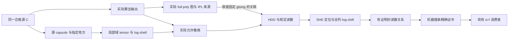

**先把源对象接上，再把明确的兼容性与读数问题交给计算：具体代码路线**

2026-10-30；单线程设计报告。承接[计算可行性调查](D:/lean/coord/reports/compute-route-feasibility-20261030.md)。用户要求的是对象、映射、接入文件和顺序；本轮不新增 Lean 实现，不宣称下面的新类型或定理已经存在。

**建议只推进这一条路线：实际源输出 → full-poly 图与源 capsule → 同一 tensor/区域上的 HDD → SHE 的局部格与全列读数 → 精确计算证书 → 现有 xi-f 消费者。** 不先建设一套通用自动证明平台。

粘贴和兼容性不是可以跳过的步骤，其中一部分正是当前的数学困难。但也不必把所有兼容性先证明完才允许用 AI：源对象、操作和目标类型准确后，AI 就可以搜索某个具体方形或读数相容性的证明。只有把大量标量关系交给自动消元时，才要求这些关系已经有可用的源证明。

下面是拟实现的依赖图，箭头不代表本轮已完成的构造：



**一、先把三个容易混淆的输入分清。**

| 名称 | 当前实际类型/文件 | 在新路线中的职责 |
|---|---|---|
| I_src | [SourceOriginalInput.OriginalInput](D:/lean/LeanFormal/IUT/IUTIII/Theorem311/SourceOriginalInput.lean:41) | 保存 initial、theater family、ℤ×ℤ 标签及共同算术数据。后续对象均依赖这一个源实例；它的字段齐全不自动保证所有更深源语义已核验。 |
| I_red / carrier | [ParametricCarrier.Carrier](D:/lean/LeanFormal/IUT/IUTIII/Theorem311/ParametricCarrier.lean:25)、[Theorem311Output](D:/lean/LeanFormal/IUT/IUTIII/Theorem311/SourceFaithfulBoundary.lean:1584) | 现有 reduced 算法及其证明供体。不能凭同名 I 或 Output 把它与源输出认作同一对象。 |
| C3 | [SourcePilotRegionData](D:/lean/tmp/sheaf/n8/closure/SourcePilotRegion.lean:62) | 当前实际完备化、q、根、tensor 地方等的条件数据包。它依赖 I_src，但无条件构造未给出；其整包存在不能当作已经完成。 |

尤其，C3 含固定完备域中的 NatRootSystem 等较强字段。原文要求什么根、在哪个允许扩张里，就使用什么；不要为连接一个 tensor/log-shell 先承诺构造这个整包全部字段。只需要地方和局部域的供体，可以直接从合法的源地方实例化。这里沿用此前 F/K 的语义纠正。

**二、第一接头：把“这次算法输出”接到已有 prime-strip 图。**

已有两端：

- 算法端：[AlgorithmInput / AlgorithmOutput / runAlgorithm](D:/lean/LeanFormal/IUT/IUTIII/Theorem311/ParametricCarrier.lean:403)记录 Choice 和 route；[sourceAlgorithmOfCarrier](D:/lean/LeanFormal/IUT/IUTIII/Theorem311/Output/SourceMultiradialPresentationWiring.lean:241)把它包装为 reduced 源算法。
- 图端：[SourceFTimesMuPrimeStripRem3102Diagram](D:/lean/LeanFormal/IUT/IUTIII/Theorem311/SourceFTimesMuPrimeStripPolyIsomorphism.lean:805)已有八个 strip、上下横向箭头、四个 Kummer 方向箭头及三个交换方形；[iplLink](D:/lean/LeanFormal/IUT/IUTIII/Theorem311/SourceFTimesMuPrimeStripPolyIsomorphism.lean:845)已有复合公式。

已有辅助函数可以直接复用：SourceFTimesMuPrimeStrip.canonical、SourceFTimesMuPrimeStripEquivalence.canonicalLift、SourceFTimesMuPrimeStripFullPolyIsomorphism.ofEquivalence / comp；[fPrimeStripAt / fLinkAt](D:/lean/LeanFormal/IUT/IUTIII/Theorem311/SourceH1H2Construction.lean:52)给出源 family 的相应候选对象和箭头。这些只供应 carrier/运输运算；不能据此宣布它们就是某次实际 evaluation 的箭头。

**拟接入位置**：`D:/lean/LeanFormal/IUT/IUTIII/Theorem311/Output/SourceOutputPrimeStripInterpretation.lean`（新文件建议，尚不存在）。消费者是现有 [iplAlgorithmicProvenanceCard](D:/lean/LeanFormal/IUT/IUTIII/Theorem311/Output/SourceMultiradialIplLinkWiring.lean:190)。

这个文件的任务不是新增一个含 `compatible : Prop` 的总包，而是完成三件有具体来源的事：

1. 对真实源算法产生的输出及中间输出，构造其 strip 解释。若当前 Choice 已丢失源生成数据，就在源一侧保留这些数据，再给出到 reduced Choice 的遗忘函数；不能从任意弱 Choice 反向猜一个 strip，也不强求遗忘函数是双射。
2. 把算法中实际出现的 lowerEnv、lowerGau、verticalEnv、upperEnv 等操作解释为图中对应箭头。各箭头由对应源操作构造，而不是先任取八个同构、再用定义强制交换。
3. 证明该解释的遗忘结果就是原算法的输出；并证明这次操作生成的箭头与图中的箭头相同或属于原文要求的相同 poly-isomorphism 类。已有图的复合/消去定理随后直接复用。

签名草案如下；SourceRun 是**拟保留实际源生成数据的类型**，不是已经存在的 Lean 声明；此处仅说明接头形状：

```text
forgetRun    : SourceRun C m → reduced Choice
stripOfRun   : (r : SourceRun C m) → SourceFTimesMuPrimeStrip V
diagramOfRun : (r : SourceRun C m) → Rem3102Diagram（该 r 产生的八个 strips）

forgetRun_of_source_execution : 遗忘实际源运行 = 已有 reduced 运行结果
evaluation_arrow_from_source : 图中的 evaluation 箭头 = 该次源 evaluation 产生的箭头
ipl_from_source_execution    : 图的 iplLink = 该次源操作复合所给的 linking class
```

实际设计应先手写一段确定的源操作链，不先开发任意算法 DSL。SourceRun 内不能塞入 `Q≤H`、最终 q membership 或完整 source comparison。它保留的是输入、合法选择和操作实际产生的数据。

首个具体方形就是四个已构造源箭头之间的目标：

```text
lowerEnv   : bottomEnv → bottomGau
verticalEnv: bottomEnv → topEnv
verticalGau: bottomGau → topGau
upperEnv   : topEnv → topGau        -- 这次实际 evaluation

lowerEnv ≫ₜ verticalGau = verticalEnv ≫ₜ upperEnv
```

编码顺序应是“构造四条源箭头 → 证明上式 → 填入 diagram.commEnv → 调用已有复合定理”。不能先要求一个已经含 commEnv 的 D，再用 D.commEnv 作为这项工作的证明；也不能把未知 upperEnv 定义成另三条箭头的复合后，就宣称它是实际 evaluation。

**第一包的精确边界**：先处理这一接头，选定 source evaluation 对应的 upperEnv 一侧，列清其输入/输出 strip 和实际运算，再连接其相邻 Kummer 方形。若当前代码只有泛型 fLinkAt/self-conjugation，就停在“该 evaluation 的实际源构造”这个精确义务；不得把 generic link 直接改名为实际 evaluation。现有 [LogKummerCorrespondenceFromSource](D:/lean/tmp/sheaf/xif/paper/LogKummerCorrespondenceFromSource.lean:134)正好说明这个区别：它能构造并复合给定 source links，尚不因此证明算法来源。

**三、第二接头：把源 capsule 的地方接到实际 tensor/log-shell。**

这一步解决“这些 strip 上的运算到底在哪个局部域和 tensor 中发生”。入口是同一 I_src 的 procession/capsule 与原规定的地方选择；出口是那一个 capsule 对应的实际局部域族、tensor、log-shell 区域和嵌入。

**拟接入位置**：`D:/lean/LeanFormal/IUT/IUTIII/Theorem311/Output/SourceCapsulePacketRealization.lean`（新文件建议）。复用 [H2FProcession](D:/lean/LeanFormal/IUT/IUTIII/Theorem311/SourceH1H2Construction.lean:1110)、[SourceLogShellActualIQTensor](D:/lean/LeanFormal/IUT/IUTII/Kummer/SourceLogShellActualTensorSpan.lean:67)和 [exists_realized_tensorLogShell_hull](D:/lean/LeanFormal/IUT/Foundations/LocalFields/FinitePadicTensorLogShellRealization.lean:23)。

索引应来自实际 capsule/tuple，而不是要求整个 V 等于某个有限 tensorIndex。当前 [PrimeStripC3PlaceComparison](D:/lean/tmp/sheaf/xif/paper/PrimeStripLogShellActual.lean:109)含 `V ≃ C3.tensorIndex`，不能把它强加为一般源输入都要满足的要求。更合适的接头形状是：

```text
κ                 = 源文规定的某个 capsule/tuple（保留符号、重数和选择）
FactorIndex κ      = κ 的实际有限因子索引
stripIndex κ       : FactorIndex κ → V
placeOf κ          : 每个因子所对应的源指定地方
localFieldOf κ i   = 该源地方的实际完备化
packetOf κ         = 这些局部域/log-shell 的实际 tensor packet
```

这里的映射不是任意选择；要从源 capsule 和地方数据取出，并证明 strip 的该因子和这个完备化表示的是同一源局部对象。跨 F→K 时使用实际扩张映射和相应次数/归一化，不能为了方便强加域同构。

需要的具体定理是：源选择的地方确实对应、局部 log-shell 在解释下对应、pure tensor 的解释与各因子解释一致。若现有 C3 恰好就是这一实例，再建立适配器消费 [actualC3LogShellTensorPacket](D:/lean/tmp/sheaf/xif/paper/C3LogShellTensorPacketActual.lean:133)；没有该身份时，直接复用底层 tensor 供体，避免为迁就 C3 添加不必要的根假设。

**四、第三接头：把实际允许像族接入 hull+det，而非只接入一个 carrier。**

**拟接入位置**：`D:/lean/LeanFormal/IUT/IUTIII/Corollary312/SourceHDDReadout.lean`（新文件建议）。它消费前两接头，处理 Formalization §4 的 dsc→hull+det。

对每个源 capsule，构造 `imagesOfRun`：每个元素都来自那一次算法的允许整包选择及实际 evaluation。不能用任意 `Set X`、单位球或只遍历 signed j 的数值族替代。实际输出的来源信息必须能追溯，Ind1–3 的依赖不能被拆成彼此独立的选择。

随后构造规定的 hull、Stp5 的全局等体积替代、Stp6 的 determinant 与有理幂次。所需模块、秩、参考区域和权重必须由这次源对象给出。这里应允许 region containment 和有符号读数不等式，不要把每一步强制成同构或相等。

应证明的接头定理包括：

```text
evaluation_into_packet       : 实际 evaluation 的值落入第二接头的 packet
allowed_images_source        : imagesOfRun 的成员确来自源允许的整包选择
transport_images            : 对指定的合法表示变换，像族按该变换对应/包含
transport_hull              : 由前一条推出所需 hull 对应/包含
hdd_readout_formula         : 真实 HDD 读数 = 带源参考项、幂次、权重的表达式
```

对于 field-product 分解选择，已有 [tensorLogShellHull_decomposition_change](D:/lean/LeanFormal/IUT/Foundations/LocalFields/FinitePadicTensorLogShellTransport.lean:46)可以作为供体。对于实际拓扑加群同构，同时运输区域与参考区域后，可复用 [relative_log_mass_image_eq](D:/lean/LeanFormal/IUT/Foundations/LocalFields/NormalizedHaarTransport.lean:39)。这不能跨越其假设：嵌入不是同构，Θ-link/log-link 也不能擅自当作同一个环上的拓扑加群同构。

这一层才是读数相消的第一个合适入口。即使暂时无法给出一个完整对象级等价，也可以尝试直接证明足够的读数运输等式/界；但它必须关于同一真实源像族，且不能直接假设最终 Q_C≤H_C。

**五、第四接头：将同一个 HDD 对象放进 1-column 的算术结构，证明 SHE 与移位兼容。**

**拟接入位置**：`D:/lean/LeanFormal/IUT/IUTIII/Corollary312/StepXI/SourceSHEHDDCompatibility.lean`（新文件建议）。输出供现有 SHE/APT 消费，同时生成后续计算真正可用的源读数引理。

现有 [SourceArithmeticVectorBundle](D:/lean/LeanFormal/IUT/IUTIII/Theorem311/SourceArithmeticHolomorphicLanding.lean:210)只保留一个 carrier 和 localizations；[SourceLocalizationExpression](D:/lean/LeanFormal/IUT/IUTIII/Theorem311/SourceArithmeticHolomorphicLanding.lean:243)是逐地方存在某个 section 的弱条件。因此不能仅填这个旧 record 验收 SHE。

具体做法是让第三接头的输出带真实局部格/有限生成模，再解释在规定 1-column 的完备局部环中。选定合法局部平凡化时，可以用 `Submodule O_v (Fin r → K_v)` 这类类型表示格；r 和 O_v/K_v 来自实际输出与源地方，不任取。若源对象需投射模或非平凡线丛，就保留相应结构，不强迫一个全局自由基或一个全局截面存在。

该层需要的实际数据/定理：

```text
oneColumnAt C m             : 标签 (1,m) 的实际算术局部环/域族
hddLocalLattice C m o v     : 这次 HDD 输出在 v 的局部格/模
sheLocalization C m o v    : 同一输出在 1-column 的源定位表达
localize_hdd_compat         : 源定位与该次 HDD/determinant 操作相容
readout_reference_compat    : 两种呈现的参考项、权重与符号一致
logShift_readout_compat     : 相邻 m、m+1 的规定 log-volume 读数相容
indeterminacy_sync          : 全列使用源要求的同步不定性关系
```

这里的 `localize_hdd_compat` 不是要求所有地方的任意截面拼成一个全局截面，也不把不同算术地方当成一张开覆盖。若需要 descent/cocycle，就按实际的基变换/重叠图来建立它。旧 [marked-trace 更正](D:/lean/tmp/sheaf/n8/closure/C9-U2K2-SQ3-MARKED-TRACE-20261026.md:164)已经说明泛型 conjugation 验算不能替代这些数据。

完整 m∈ℤ 用参数化的一步定理和原文要求的同步/迭代关系处理。`RouteStep.ind3 : Nat` 的 reduced 预算不能直接代替整个 ℤ 列；[RouteStep 定义](D:/lean/LeanFormal/IUT/IUTIII/Theorem311/MultiradialProfileKernel.lean:121)对此并未建模。

若该部分对象级比较太强，优先搜索局部格产生的**读数不变量**：例如表示改变的误差由一个有实际来源的势函数差分控制。必须提供该函数及其一步证明，而不是把“有一个消掉误差的势函数”放入新字段。

**六、机器计算具体在哪里接入。**

建议接入两个位置，职责不同：

| 接入点 | 机器输入 | 机器寻找什么 | 回到哪里验收 |
|---|---|---|---|
| 第一至第四接头中的一个准确兼容性目标 | 实际对象定义、早期源定理、带标签的箭头及目标类型 | 一个方形、一条源运输公式或一步不变量的 Lean 证明 | 对应源接头文件；不能把结论改成新的输入字段。 |
| 第四接头之后的整体比较 | 已证明且已实例化的读数关系、锁定 Q_C/H_C | 精确线性/多项式/正性证书，必要时合法求和公式的相消证书 | xi-f 消费者，所有源前提仍在依赖图中可见。 |

第二个位置拟放 `D:/lean/LeanFormal/IUT/IUTIII/Corollary312/StepXI/SourceXiFReadoutCertificate.lean`。外部搜索只建议系数或候选恒等式；生成的证明调用现有 `linear_combination`、`ring`、`linarith` 或合适的核验定理，避免自建一个受信求解器。

导出关系时，每个读数原子保留 `(源 C、列标签、输入/输出层、capsule、地方、区域、测度、参考、权重)` 的身份。只有已证身份等式才能合并原子。JSON 的名称或 hash 只是追踪信息，不能替代 Lean 的类型和证明。

最终连接方式是从这些源引理和证书**证明**现有 [ThetaLinkActual.link_implies_inclusion](D:/lean/tmp/sheaf/xif/paper/ThetaLinkActual.lean:181)所要求的命题，再交给 [PaperXiFCompileGate](D:/lean/tmp/sheaf/xif/paper/PaperXiFCompileGate.lean:69)。不修改最终目标，不把 q 定义成 HDD 输出，也不把这个字段本身作为求解器输入。

高阶展开/creative telescoping 只在第三或第四接头实际出现合格的求和/递推表达式时接入；它的消费者就是 `hdd_readout_formula` 或 `logShift_readout_compat` 中的某个具体子式。这样“在哪里相消”有确定答案，而不是先建一个通用 q-series 项目。

**七、下一包到底交付什么。**

下一包只处理第二节的第一接头。输入固定为同一合格源 C 及选定的实际 evaluation 操作；复用已有 strip/quotient/category 运算。交付：

1. 这次操作的源输入 strip、输出 strip，以及实际 evaluation 数据的类型和来源。
2. 从该数据构造图中对应的 upperEnv 箭头，和其相邻 Kummer 方形的精确交换目标；不能用无关 generic link 代填。
3. 与 reduced 输出的遗忘关系，以及后续 capsule/tensor 消费这一结果的位置。

验收要么获得这个具体源构造及相应证明，要么准确停在首个未构造的 source evaluation 子引理，并给出对象、量词、现有供体不足之处。不要在这一包同时展开全局根论、所有 Haar 公式、全部 SHE 或优化训练。

这个顺序也修正了前一份“先做关系表”的表述：**不能先填一张脱离源运算的标量表。先把关系表的第一批原子和关系绑到上述接头；随后计算才有明确消费者。** 这不是要求所有基础证明完才推进上层；准确的源定理可作为显式条件用于局部探索，但未证明的传递依赖始终保持 open。

**本轮状态。** 已定位实际对象、断开的接头、可复用函数、拟写文件和下一包范围；没有构造新的 SourceRun、evaluation、HDD 或 SHE 实例。所有拟写签名均为阶段 1 设计，不是已编译 Lean。statement_compiles/proof_body_checked/kernel_closed=not_run；target_accepted=false；未运行 solver、Lean、Project、comparator、公理检查或独立审查。证据见[版本清单](D:/lean/tmp/sheaf/source-compute-integration-20261030/evidence.json)和[机械核对](D:/lean/tmp/sheaf/source-compute-integration-20261030/verification.json)。
